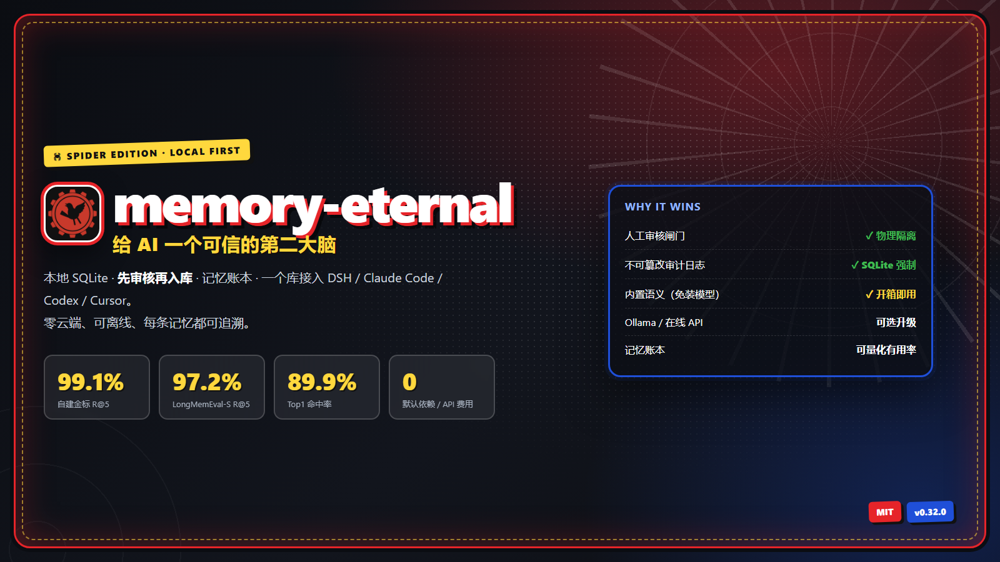
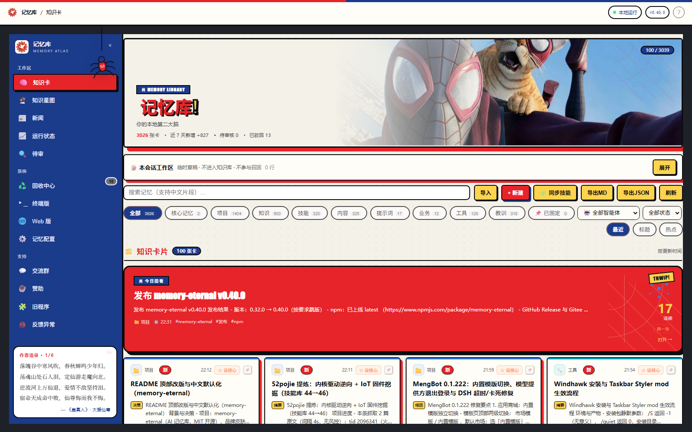
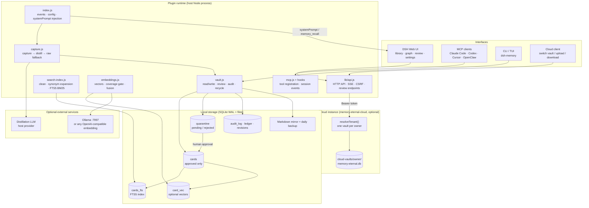

# 🧠 memory-eternal — a second brain for your AI

<p align="center"></p>

<p align="center"></p>

<p align="center">
  
  
  
</p>

**English** · [简体中文（默认）](README.md)

## ☁️ Cloud memory

**Your vault follows you, not the machine.** The local vault still works offline; sign in to your cloud instance
and the same cards are readable from every device and every agent — no migration on a new laptop, no re-feeding
context to a new client.

| Capability | What you get |
|---|---|
| **One sign-in** | MengBot account (QR / email OTP) or an access key (`me_…`) issued on any instance |
| **One vault per user** | The cloud instance shards by owner — **each user gets an isolated SQLite file** (`cloud-vaults/{owner}/memory-eternal.db`) |
| **Hot vault switch** | Local ↔ cloud without a restart (`POST /vaults/switch`): cards, graph, review queue, recycle bin and stats all re-source at once, no page reload |
| **Upload / download** | Whole-vault copy (local → cloud, cloud → local) with chunked transfer, **resumable uploads**, cancel mid-flight, 3 retries, and duplicate-skip |
| **Offline first** | An unreachable cloud trips a circuit breaker and falls back to the local vault within 3 s; local memory is untouched |
| **Your own instance** | Self-host `memory-eternal-cloud` (systemd / Docker + HTTPS reverse proxy); keys are issueable, revocable and stored as sha256 only |
| **Three ways to issue keys** | **CLI** (`dsh-memory cloud keys issue` — no admin token needed on the host) · **panel** "🔑 Server key management" · curl; the admin token is auto-generated on first boot |

```bash
# 1) start a cloud instance (off by default; without it you are purely local)
MEMORY_CLOUD=1 node lib/web.js --port 7999     # the cloud server is a separate private project, not in this repo
# first boot auto-generates the admin token -> $DSH_HOME/cloud-admin-token (0600, printed once)

# 2) issue an access key (pick one)
dsh-memory cloud keys issue --owner alice --note laptop   # CLI: shell access = admin, no token, effective immediately
# or: panel -> Settings -> 🧪 Experimental -> Cloud connection -> "🔑 Server key management" -> paste admin token -> New
curl -X POST http://127.0.0.1:7999/memory-eternal/api/cloud/keys \
  -H "Authorization: Bearer $MEMORY_CLOUD_ADMIN_TOKEN" \
  -H 'Content-Type: application/json' -d '{"owner":"alice"}'

# 3) panel: Settings -> 🧪 Experimental -> Cloud connection -> URL + key -> [Test] -> [Save & switch]
```

> Behind a reverse proxy or in a container, set two variables: `MEMORY_CLOUD_ADMIN_TOKEN` (used if set; otherwise the auto-generated token on disk wins) and `MEMORY_PUBLIC_HOST` (Host allowlist for write requests — put your domain there).
> Boundary: the cloud server (multi-tenant + auth + billing) is a **separate private project** (own private repo); its source is not in this repo and is not
> shipped with this open-source package; those endpoints are still moving fast and may shift. Ignore the cloud
> entirely and everything behaves exactly as before.

## 💳 Subscriptions & multi-vault (cloud edition)

Cloud instances ship **plan-based quotas**. Three paid tiers, effective immediately after payment.

| Tier | Cards | Vaults | Rate |
|---|---|---|---|
| Free | 500 | 1 | 60/min |
| **Personal** | 20,000 | 1 | 150/min |
| **Team** | 100,000 | 3 | 300/min |
| **Flagship** | 1,000,000 | 10 | 1000/min |

| Capability | Detail |
|---|---|
| **Multi-vault** | Several vaults per account (up to plan limit), each an isolated SQLite; rename independently, issue per-vault pair codes |
| **Rename the default vault** | Personal has only one vault, so the default one is renameable (server moves the tenant root into `vaults/<name>/`) |
| **Server-enforced quota** | Vault creation and card writes are checked server-side; over-limit returns `quota_exceeded` with used/limit |
| **Self-service console** | `/api/console` shows subscription, manages vaults, issues pair codes, renames vaults — every action has toast feedback |
| **Payment** | WeChat / Alipay QR (manual confirm) or XORPay callback; all tiers orderable, renewals extend the expiry |

> Quotas were revised: personal used to be 2,000 cards, which hit existing users with 10k+ cards immediately. Now 20,000.
> See `PLAN_QUOTA` in `lib/quota.js` and `PLANS` in `lib/pay.js` (must stay in sync).

```bash
# start a cloud instance (off by default; without it you are purely local)
MEMORY_CLOUD=1 node lib/web.js --port 7999

# API-only mode: no vault UI, / redirects to the console
MEMORY_CLOUD=1 MEMORY_CLOUD_NO_UI=1 node lib/web.js --port 7999
```

---
## 📊 How it compares — measured, not advertised

> Data date **2026-11-18**: stars come from the GitHub API (raw integers); public scores are transcribed from each
> project's own README / paper **in their own metric**, and metrics are never mixed in one column. Visual version:
> [bench/comparison.html](bench/comparison.html); methodology and repro scripts: [bench/COMPARISON.md](bench/COMPARISON.md).

**Table 1 · Memory class: overall judgement (10 weighted dimensions, our own rubric)**

| Rank | Project | Recall | Semantics | Privacy | Governance | Cost | Total |
|---|---|---|---|---|---|---|---|
| 🥇 1 | **memory-eternal (Ollama)** | 8.6 | 8.6 | 9.5 | 9.0 | 8.0 | **8.54** |
| 🥈 2 | **memory-eternal (built-in)** | 7.1 | 6.8 | 9.5 | 9.0 | 9.5 | **8.48** |
| 🥉 3 | Mem0 (69.1k★) | 9.3 | 9.0 | 6.0 | 6.0 | 6.5 | 7.49 |
| 4 | MemOS (12.4k★) | 8.5 | 8.5 | 7.0 | 6.0 | 7.0 | 7.38 |
| 5 | graphiti (32.9k★) | 7.8 | 8.5 | 8.0 | 6.0 | 7.0 | 7.26 |
| 6 | basic-memory (4.6k★) | 6.5 | 6.5 | 9.0 | 6.0 | 9.0 | 7.26 |
| 7 | Letta (25.5k★) | 8.0 | 8.5 | 8.0 | 6.0 | 6.5 | 7.22 |
| 8 | mcp-memory-service (2.1k★) | 6.0 | 6.0 | 9.0 | 5.0 | 9.5 | 7.17 |
| 9 | memobase (3.0k★) | 7.2 | 7.0 | 8.0 | 6.0 | 8.0 | 7.15 |
| 10 | cognee (33.4k★) | 8.0 | 8.5 | 8.0 | 5.5 | 7.0 | 7.14 |
| 11 | supermemory (31.6k★) | 8.0 | 8.0 | 6.5 | 5.5 | 6.5 | 7.14 |
| 12 | Zep (5.0k★, closed product) | 7.0 | 7.5 | 6.5 | 6.5 | 6.0 | 6.88 |

**Table 2 · Memory class: public benchmarks and deployment hard facts**

| Project | Stars | Public score (as reported) | Local / zero API | Human review gate |
|---|---|---|---|---|
| **memory-eternal (bge-m3)** | 196 | **R@5 97.2%** on our own 500-question set (retrieval) | needs Ollama | ✅ |
| **memory-eternal (built-in)** | 196 | **R@5 95.4%** on our own 500-question set (retrieval) | ✅ / ✅ | ✅ |
| Mem0 | 69,120 | LongMemEval 94.4 (**managed platform** figure, not the OSS build) | partial | weak |
| cognee | 33,371 | BEAM 100K 0.79 / BEAM 10M 0.67 (0–1 scale) | partial | medium |
| graphiti | 32,889 | no LongMemEval / LoCoMo number in the repo | partial | medium |
| supermemory | 31,644 | LongMemEval **R@15 95%** (~720 tokens) | partial | weak |
| Letta ※ | 25,471 | no LongMemEval / LoCoMo number in the repo | partial | medium |
| MemOS | 12,435 | LongMemEval 89.20 (OmniMemEval) | partial | medium |
| Zep ※ | 5,007 | paper: LongMemEval accuracy **+18.5%** over MemGPT, −90% latency | ❌ | medium |
| basic-memory | 4,612 | no public memory benchmark number | ✅ / ✅ | weak |
| memobase | 2,960 | LoCoMo 75.78 (third-party reproduction, LLM-Judge overall) | partial | medium |
| mcp-memory-service | 2,135 | LongMemEval-S **R@5 86.0%** with zero LLM calls | ✅ / ✅ | weak |

> ※ **Status that has to be stated**: `getzep/zep` is a samples/integrations repo for Zep Cloud — the product itself is
> closed source (the open graph engine is graphiti). `letta-ai/letta` is archived with active source in `letta-code`.
> Neither star count should be read as "the open-source build".

## 🏷 Command names and aliases

The repo and plugin id remain the neutral **memory-eternal**; the npm package name became **mengbot** in Nov 2026 (new account), while the CLI is still `dsh-memory`
(back when it served DSH only). All three spellings are the same entry point today:

| Command | Where to use it |
|---|---|
| `memory` | Primary name. Any host, plain CLI, scripts |
| `mem` | Short alias, less typing |
| `dsh-memory` | Compatibility entry. Old docs, old scripts and the DSH plugin still use it; it will not be removed |

```bash
memory status --port 7999      # same as dsh-memory status --port 7999
mem peer code                  # same as dsh-memory peer code
```

The data location is equally flexible: `MEMORY_VAULT_DIR` (vault directory), `MEMORY_DB_FILE` (database filename)
and `MEMORY_WEB_PORT` (port) are all configurable, so the vault does not have to live under `~/.dsh`.

## ⚡ Quick start

```bash
# DSH desktop / web
dsh plugin --profile desktop add mengbot     # reopen DSH -> sidebar "Memory"

# Same vault for Claude Code / Codex / Cursor (MCP)
npm i -g mengbot && dsh-memory connect claude

# Any MCP client (MengBot / OpenClaw / Hermes: docs/INTEGRATIONS.md)
npx -y -p mengbot dsh-memory mcp

# Cloud bots / remote agents: plain HTTP, no local process needed
curl -s http://127.0.0.1:7999/memory-eternal/api/mcp \
  -H 'content-type: application/json' \
  -d '{"jsonrpc":"2.0","id":1,"method":"tools/list"}'

# Browser / terminal
dsh-memory open                             # http://127.0.0.1:7999
npx -y -p mengbot dsh-memory tui     # live review queue in the terminal
```

<p align="center"><strong>⭐ If it saves you from explaining the same context again, a star helps a lot.</strong></p>

## 🧾 Does it actually save tokens?

Most memory products <em>say</em> they save tokens. We think you should check. The plugin ships a built-in **memory ledger** (Runtime status → Memory ledger):

| Recorded | What it means |
|---|---|
| recall: hits + injected characters | how much memory actually entered the context |
| capture: LLM calls + input/output characters | what distillation cost you |
| usefulness: useful / not-useful feedback | whether recalled memories actually helped |

```text
net benefit ≈ avoided context cost − (injected characters + distillation calls × price)
```

| Scenario | You pay | You avoid |
|---|---|---|
| Multi-session project with decisions and pitfalls | ~0.6–0.9k tokens per recall | re-explaining context (~1.5–3k) or re-reading files (3–6k) |
| One-off question, low hit rate | recall injection | usually nothing |

> Illustrative numbers, not a benchmark — measure your own with the ledger. If recall usefulness stays below ~60%, tune it down or turn memory off.
> Once you are on the cloud, the ledger is per vault: local and cloud count separately, one statistic per vault.

## 🛡️ Review first, prove later

A memory system that silently ingests everything will eventually recall a wrong fact as truth. memory-eternal defaults to **review-before-commit**:

- new cards land in a **pending queue**; nothing enters the main vault until a human approves it;
- approve, reject or bulk-process from the Web UI, the terminal TUI, or the CLI;
- every status change is appended to an **immutable audit log** (who / what / when / why) — enforced at the SQLite layer, not by convention;
- agents can read and propose, but **cannot approve their own cards**;
- agents can also submit a **revision**: a copy of an approved card lands in the queue marked "✏️ revision of …"; approving it overwrites the original, rejecting it leaves the original untouched;
- deleted cards go to a recycle bin (30 days by default).

> The cloud keeps the same gate: switching to a cloud vault only swaps the **data source**, never the rules —
> pending cards on the cloud still need a human approval.

## ⭐ Core memory

Not everything should be injected into every session. Core memory is the small, explicit set of rules and preferences that must always win:

- any approved card can be promoted from the reader or card list;
- auto-capture may **suggest** core only for explicit long-term preferences / hard constraints, and core candidates always stay pending for review;
- approved core cards are injected into the system prompt of every session — no `memory_recall` call needed;
- set a card limit and character budget in Settings → Memory → Core memory;
- in the knowledge graph, core nodes are orange diamonds with a ★;
- never store secrets or API keys in a core card; keep only a pointer to the credential directory.


## 🧩 Supported hosts (one vault, every host)

One SQLite vault that all of the following can read from and write to. Every write lands in the **review queue**; approving happens in the DSH / Web panel, regardless of which host wrote the card.

**15 harnesses in one glance** · `✅` one-click mount · `⚠️` conditional · `➖` paste one entry · `❌` no MCP config

### 🌍 International

| Harness | Kind | Config location | Mount |
|---|---|---|---|
| **DeepSeek Harness** | plugin (embedded panel) | `~/.dsh/mcp-servers.json` | ✅ auto with the plugin |
| **Claude Code** | CLI / IDE plugin | `~/.claude.json` | ✅ `connect claude` |
| **Codex CLI / Desktop** | CLI | `~/.codex/config.toml` | ✅ `connect codex` |
| **Cursor** | IDE | `~/.cursor/mcp.json` | ✅ `connect cursor` |
| **Windsurf** | IDE | `~/.codeium/windsurf/mcp_config.json` | ✅ click in the panel |
| **Cline** | VS Code extension | `~/.cline/data/settings/cline_mcp_settings.json` | ✅ click in the panel |
| **Gemini CLI** | CLI (Google) | `~/.gemini/settings.json` → `mcpServers` | ✅ click in the panel |
| **Antigravity** | **desktop IDE** (Google) | `~/.gemini/config/mcp_config.json` → `mcpServers` | ✅ click in the panel |
| **OpenClaw** | gateway (JSON5) | `~/.openclaw/openclaw.json` → `mcp.servers` | ✅ refuses files with comments |
| **Hermes Agent** | CLI (YAML) | `~/.hermes/config.yaml` → `mcp_servers` | ✅ replaces only its own block |
| **VS Code Copilot** | IDE | portable `mcpServers` | ➖ paste one entry |
| **Gemini desktop app / web** | chat client | no MCP config exposed | ❌ not an MCP host (Google's desktop harness is Antigravity) |

### 🇨🇳 China

| Harness | Kind | Config location | Mount |
|---|---|---|---|
| **MengBot** | bot platform | in-app “Settings → MCP servers” / project `.mcp.json` | ⚠️ writes the project file only with `MEMORY_HOST_MENGBOT_PROJECT` |
| **Qwen Code** | CLI (Alibaba, Gemini-CLI fork) | `~/.qwen/settings.json` → `mcpServers` | ✅ click in the panel |
| **Kimi CLI** | CLI (Moonshot) | `~/.kimi/mcp.json` | ✅ click in the panel |
| **GrokBot** | desktop client | `~/.grokbot/mcp.json` / `%APPDATA%\GrokBot\mcp.json` | ✅ click in the panel (undocumented format, detected by convention) |
| **Zhipu / ZhipuAI** | desktop / web | add inside the app | ➖ detect only |
| **WorkBuddy** | desktop client | add inside the app | ➖ detect only |
| **Cherry Studio** | desktop client | in-app “Settings → MCP servers” | ➖ no external config file |

### ☁️ No local process needed

| Channel | How |
|---|---|
| **Cloud bots / remote agents** | `POST /memory-eternal/api/mcp` (Streamable HTTP; `Bearer me_…` on cloud) |
| **Terminal TUI** | `npx -y -p mengbot dsh-memory tui` — live queue, select-all, batch approve/reject |
| **Web panel** | `dsh-memory open` → http://127.0.0.1:7999: review / search / backup, standalone |

Project onto several hosts at once: `dsh-memory mcp mount --host gemini,qwen,kimi` (`--host all` for everything). Field names, snippets and pitfalls: [docs/INTEGRATIONS.md](docs/INTEGRATIONS.md); Orca launcher: [orca-plugin](orca-plugin/README.md); editor extension: [cursor-extension](cursor-extension/README.md).

> MCP is just a standard stdio server with 5 tools: `memory_recall` / `memory_capture` / `memory_stats` / `memory_audit_list` / `memory_revise`. Anything not listed works with the same stdio snippet.


**We are not the biggest here.** Mem0 has 69k stars and a funded team. What we do differently is the
**write path**: a human gate, physically separated stores, an audit trail you can point at, plus a ledger so you can
check whether recall is actually worth its cost — that is the "governance" column in Table 1, not a tagline.

Reproduce the numbers on **your own vault**:

```bash
node scripts/bench-search.mjs --rebuild   # rebuild time + p50/p95/max latency
node scripts/bench-recall.mjs             # golden-set R@5 / Top1
dsh-memory ledger --days 30 --json        # recall injection / capture calls / usefulness
```

| Our measured baseline (2026-11-12, 2,943 cards) | Value |
|---|---|
| Golden 109 R@5 (built-in / bge-m3) | 96.3% / **99.1%** |
| Golden 109 Top1 (built-in / bge-m3) | 86.2% / **89.9%** |
| Paraphrase 10 R@5 (built-in / bge-m3) | 40% / **70%** |
| LongMemEval-S 500 R@5 (built-in / bge-m3) | 95.4% / **97.2%** |
| Recall latency (lexical / semantic) | ~7 ms / 81 ms |
| Recall model calls (built-in) | 0 |

> Retrieval ≠ QA. Our two rows in Table 2 are **retrieval R@5**; Mem0's 94.4 is a self-reported **LongMemEval QA**
> number on their managed platform. The columns are not comparable.

## 🔍 Semantic recall (built-in by default, no model required)

**Fresh installs use built-in semantics**: zero install, zero network, zero cost; synonym expansion as the semantic fallback. Three deployment modes:

| Mode | Notes |
|---|---|
| Built-in (default) | Zero dependencies; R@5 96.3% on our set, paraphrase 40% |
| Local Ollama (recommended upgrade) | bge-m3 vectors; R@5 99.1%, paraphrase 70%, ~100 ms (cold start included; warm query embedding measures 28–35 ms) |
| Online API | OpenAI-compatible endpoint, pay per call |

The first visit to the memory page runs a 3-step guide with everything on by default: memory core / auto-capture / auto-recall / core-memory injection / working memory / built-in semantics. Re-open it from **🧭 Guide** in Settings → Semantic recall. Details: [docs/EMBEDDINGS.md](docs/EMBEDDINGS.md).

## 🎨 Skins & UI

Five skins, switch in Settings → General → Theme with one click. The choice is saved locally and survives reloads.

<p align="center">
  
</p>

| Skin | Style |
|---|---|
| **Default** | Dark base + amber accent, easy on the eyes |
| **Pop** | Yellow paper, black frames, hard shadows and halftone |
| **Light** | Warm paper + serif headings for daytime |
| **Resident Evil** | Umbrella lab, toxic-green scanlines, B.O.W. banner and claw |
| **Spider-Man** | Red/blue comic, webs, halftone, wide action banner and hanging charm |

<p align="center">
  
  
</p>
<p align="center"><sub>▲ Cards · Knowledge graph — <a href="https://eternalnight996.github.io/memory-eternal/demo/">live demo</a></sub></p>

## 🏗 Architecture: one vault, one gate, two read paths



The diagram is only true because three invariants are enforced in code, not by convention:

| Invariant | Enforced by |
|---|---|
| The main store **only** ever contains approved cards | Two physical tables; every read path queries the main one |
| An agent can never approve its own memory | Agent writes land in quarantine; approve/reject is a human action in the UI / TUI / CLI |
| Recall costs **zero model calls** | FTS5 + BM25; the LLM runs only while distilling |

> The cloud adds exactly one edge: `API → resolveTenant() → that owner's own vault`. No shared tables between tenants, so data cannot leak across.

### 🔁 What actually happens in one session

The host agent does not "read a folder". It walks a chain with budgets, a gate, and fallbacks:

| # | When | What runs | What it does | Blocks the chat? |
|---|---|---|---|---|
| 1 | Session start | `index.js` | Assembles systemPrompt sections: **core memory** (`order 120`, ≤6 cards / ≤2000 chars), the session scratchpad, the **auto-recall rules** (`order 600`), optional news digest. Core memory is recomputed every 5 s and rebuilt only when it changes | No |
| 2 | You ask | Host agent | Normal reasoning. Whether to consult memory is its own call — the rules section only tells it *when* to look | — |
| 3 | Agent recalls | `memory_recall` tool | **In-process** call to `vault.search()` — no HTTP port involved; default 5 cards, 130 chars of summary each, 20 s tool timeout | Yes (that step only) |
| 4 | Answer | Host agent | The recall result is just another tool output, same as reading a file | — |
| 5 | Turn ends | `agent/turn-stopping` | Session events queue up → truncated to a char budget → **consecutive turns merged** (one LLM call for several turns) | No (the serial listener deliberately does not await the LLM) |
| 6 | Distill | Host LLM (`ctx.get('llm')`) | Dialogue → one card; skipped under `captureMinChars=120`; 60 s per-session cooldown; `max_tokens=4000` | No (background job) |
| 7 | Dedupe | `pickNeighbors()` | Only the **8** most related existing cards (`DEDUP_NEIGHBORS`) go to the model, which picks "new card" vs `append_to` (near-dup threshold `0.62`) | No |
| 8 | Persist | `vault.js` | Writes to `quarantine` (`status=pending`); **the main store is untouched** | No |
| 9 | Human review | You | Approve in the review center → moves to `cards` → FTS5 index (reconciled every 5 min) + vectors backfilled when enabled (`batch 16`) | — |

In one line: **the agent proposes and pulls on demand; it never decides what enters the main store.**

### 📥📤 The two read paths

They are called "two" because their context cost is fundamentally different:

| | Push: systemPrompt injection | Pull: `memory_recall` tool |
|---|---|---|
| Triggered by | The plugin, every turn | The agent, when it decides to |
| Content | Core memory (≤6 cards / ≤2000 chars) + rules + scratchpad | Title / path / summary of the top-N hits |
| Budget | `coreMemoryLimit` / `coreMemoryMaxChars`, hard caps | `recallLimit` (default 5, max 20) × `recallSummaryLen` (default 130 chars) |
| Grows with card count? | No (caps are constants) | No (count and length are constants) |
| Typical use | "Never do X", "my preferences" — constraints that must hold every turn | Past decisions, pitfalls, project background |

> There is a third, opt-in path for full text: `recallIncludeBody=true` appends up to 800 chars of body per hit — off by default precisely to keep the context small.

### 💰 Who calls a model, and when

| Moment | Calls | Sync/async | If it fails |
|---|---|---|---|
| Recall (default) | **No model**: FTS5 + BM25 inside SQLite | sync | Index error → full-table fallback scan |
| Recall (semantic on) | Ollama `bge-m3`, **one** query embedding | sync, 15 s timeout | 60 s failure cooldown → pure lexical |
| Recall (rerank on) | Your rerank model, top-30 candidates only | sync, 20 s timeout | Original order kept |
| Per-turn distill | Host LLM (fed 8 neighbour cards) | **async** | Raw source card stored (zero distill cost), still human-reviewed |
| Vector backfill | Ollama, `batch 16` | **async** | Semantic path stays off below 30% coverage |

### 🚀 Does a bigger vault make the agent slower or dumber?

This deserves numbers, not adjectives. The table below comes from the repo's own script on **synthetic vaults in a temp dir** (Windows / node v24.19.0 / 2026-11-18; ~1600 chars body per card, dim=768):

| Cards | FTS/BM25 | Vector scoring | End-to-end `search()` | Vector bytes read | **Chars injected per recall** | Corpus body |
|---|---|---|---|---|---|---|
| 200 | 0.31 ms | 1.2 ms | 28 ms | 0.6 MB | 283 chars | 0.32 M chars |
| 1 000 | 0.90 ms | 11.4 ms | 38 ms | 2.9 MB | 286 chars | 1.60 M chars |
| 2 000 | 1.61 ms | 25.8 ms | 43 ms | 5.9 MB | 304 chars | 3.21 M chars |
| 5 000 | 3.55 ms | 55.5 ms | 71 ms | 14.6 MB | 307 chars | 8.01 M chars |

(Repeat runs on the same machine wobble by roughly ±20%; the order of magnitude and the shape of the curve are what matter, not the absolute numbers.)

Reproduce it yourself (writes only to the system temp dir, never touches your vault):

```bash
node scripts/bench-capacity.mjs                  # 200,1000,2000,5000 by default
node scripts/bench-capacity.mjs 500,5000,20000   # custom sizes
```

> Capacity lives in `bench-capacity.mjs` (synthetic vaults; measures latency and injected volume); quality lives in `bench-recall.mjs` (`--vault` snapshot + golden set; measures R@5 / MRR / Top1). They are kept apart on purpose — never quote capacity numbers as quality results.

**Finding 1 — context cost is independent of card count.** Going from 50 to 5 000 cards keeps a recall at roughly 300 chars, because `limit=5` and 130 chars per card are hard truncations. Stuffing the whole corpus instead would be 8.1 **million** chars — four orders of magnitude apart. The agent always sees "5 summaries", never "a library".

**Finding 2 — latency grows far slower than intuition.** At 5 000 cards, lexical recall is 3.6 ms and end-to-end is 71 ms. The lexical path is an inverted index with a **fixed 80-row candidate pool** (`max(limit×4, 80)`), not a linear scan.

**Finding 3 — only vector scoring is truly linear.** There is no ANN index: it reads every `card_vec` BLOB and does a cosine each. At 5 000 cards that is 14.6 MB and ~55 ms — the steepest curve in the table.

So the practical capacity guidance:

| Vault size | Recommendation | Why |
|---|---|---|
| ≤ 5 k cards | Everything on: lexical + semantic + rerank | Vector scoring stays in the tens of ms |
| 5 k – 10 k | Lexical + rerank on; semantic **on demand** | Measured at 9 752 cards: 124 ms cosine / 38 MB read, ~300 ms end-to-end |
| > 10 k | Lexical + rerank; semantic only **after splitting vaults** | Splitting is the only real fix for the linear term |

### 🧪 Real-vault measurement: one index incident at 9 752 cards

A real incident is worth more than synthetic data.

The vault held 9 752 approved cards while `cards_fts` held only **50 rows** — the index stopped being filled after a bulk import, and recall **silently** falls back to "full-table scan + substring counting" when the index is missing. The same query then gives two different answers:

| Query | Index at 50 rows (fallback scan) | After rebuild (FTS5 + BM25) |
|---|---|---|
| `审核 红线 批准` | "DSH 记忆库巡检现状…" (irrelevant) | "审核中心 #27 可就地查看正文 + 批准/驳回" ✓ |
| `Ollama 语义召回` | "autokill-purge 模型清单…" (irrelevant) | "本地 Embedding 服务（Ollama/bge-m3）离线部署" ✓ |
| `npm 发布 403 账号冷却` | "0.47.0 发版前收尾…" (borderline) | "v0.49.13 发布记录与 npm 冷却问题" ✓ |

That is what "the agent got dumber" actually looks like: **not many cards — a missing index**. Nothing errors, search still returns rows; the answers just start looking like random draws.

| Metric (real vault, 9 752 cards) | Measured |
|---|---|
| Lexical recall (after rebuild) | **2.5 – 4.3 ms** |
| Index rebuild | **3.5 – 9.8 s** (one-off, 9 752 rows) |
| Full-table cosine (9 752 vectors, dim=1024, 38.1 MB read) | **124 ms** |
| End-to-end recall (semantic on, incl. one Ollama query embedding) | **250 – 314 ms** |
| Injected per recall | **~1 350 chars** (5 × title + path + 130-char summary), independent of card count |

The cost structure is plain: **lexical is nearly free; semantic costs ~0.3 s per 10 k cards.**

Ollama is a separate account: on this machine a warm `bge-m3` query embedding measures **28–35 ms** (dim=1024), and it is called **once** per recall only when semantic recall is enabled — independent of vault size. What scales is re-scoring the vault, not the model. Cold start has its own one-off cost (first model load).

As for "dumber": the failure mode was never "many cards" — it is **bad cards winning the 5 slots**. That is why the defence is a gate, not a quota:

- Only human-approved cards reach the main store (232 pending cards sit in `quarantine` and cannot affect recall);
- Distillation dedupes first (0.62 threshold): repeats are `append_to`-merged instead of piling up;
- Every recall accepts "useful / not useful" feedback, which feeds straight back into ranking (`useful×2 − useless×2`);
- Stale cards, once archived, are **physically excluded** from recall;
- The exit criterion is written into the ledger: **if the useful rate stays below ~60%, lower `recallLimit` / `recallSummaryLen` or turn memory off.**

### 🧰 Operations: when index and vectors need a manual top-up

The index is maintained **only at the moment a card is written** (`indexCardById` / `unindexCard`). Cards arriving through bulk import, Markdown migration, or an upgrade are never backfilled automatically — a known gap in the current implementation, so check it once:

```bash
node scripts/reindex-fts.mjs          # report only: approved cards vs indexed rows
node scripts/reindex-fts.mjs --force  # rebuild (writes cards_fts / _fts_rows only)
```

| Symptom | How to tell | Fix |
|---|---|---|
| Hits feel like random draws | `cards_fts` rows < `cards` rows | the two commands above |
| Semantic recall seems off | `card_vec` coverage < 30%; the gate disables it silently | Panel → Semantic recall → backfill (`batch 16`) |
| Gets slower over time | Missing index means a full-table scan per recall | same, rebuild first |

> The flip side matters too: **once the index is complete and vectors are full, recall switches from "full-table fallback" to "FTS + semantic fusion"**, and a recall goes from a few ms to roughly 300 ms (10 k cards, dim=1024). That is time spent buying accuracy, not a regression — if the trade feels wrong, turn semantic off and the lexical path stays as it was.

### 🧯 What happens when a link breaks

| Failure | Automatic behaviour | What you notice |
|---|---|---|
| Ollama not running / port closed | 60 s failure cooldown, back to pure lexical | Recall still works, synonyms get weaker |
| Vector coverage < 30% | Semantic path disabled | Same (avoids "half-indexed" ranking noise) |
| Rerank unset / timed out | Original order kept | Nothing |
| Host LLM unavailable | Raw source card stored, flagged as degraded | Cards become raw dialogue, still human-reviewed |
| FTS index broken | Full-table fallback scan | Slower, but still finds things |
| Vault file corrupted | Daily backups + auto-restore | Rolls back to the newest usable backup at boot |


## 🔗 MEM Pair: pair two vaults, exchange cards

You often run several memory-eternal instances side by side: the ops vault (7999), an isolated mem-purge (7989),
and a cloud instance. Each has its own SQLite, so they **must not share one vault** — yet you do want them to feed
each other (ops conventions → purge, purge findings → ops).

MEM Pair is that channel: explicit, auditable, and quiet by default.

| Step | How | Signal |
|---|---|---|
| Discover | LAN UDP broadcast (7990 by default), or type `host:port` | Panel lists the peer name, **pair code** and fingerprint |
| First pairing | One side starts it → the other side gets a **dialog** (6-digit handshake code, compared by eye) | Both sides list the peer |
| Reconnect | **The pair code alone is enough**: if the peer knows the code and the fingerprint is unchanged, it connects silently | Panel shows "paired → peer" |
| Fingerprint changed | Peer reinstalled, or possibly impersonated → back to manual confirmation, dialog flagged red | You confirm again |
| Move data | "Upload" (this vault → peer) / "Download" (peer → this vault); everything lands in the **peer's review queue** | Counts: sent / written / failed |

```bash
dsh-memory peer code                                  # my pair code
dsh-memory peer pair 192.168.1.20:7989                # first pairing (peer confirms)
dsh-memory peer connect 7K2M-Q9FA --host 192.168.1.20 --port 7989   # afterwards, code only
dsh-memory peer upload   --to 7K2M-Q9FA               # push cards (peer reviews them)
dsh-memory peer download --from 7K2M-Q9FA             # pull cards (this vault reviews them)
```

Security: the shared secret is derived independently on both ends from one-time ephemerals (long-term keys never travel);
every call is HMAC-signed with a ±5 min window and nonce de-dup; anything a peer sends lands in **review only**.

## 🔌 Agent MCP mounting (one standard, six hosts)

**Installed as a DSH plugin, the MCP server is mounted to DSH itself by default** (`~/.dsh/mcp-servers.json`) — usable
right away. Claude Code / Codex / Cursor / Windsurf are hosts *you* open separately, so they **must be mounted by hand** —
otherwise several agents in one repo read different vaults and their captures get mixed up.

All hosts share one standard (declare once, render everywhere): the server name is always `memory-eternal`, stdio only,
absolute paths, parameters via `env`, idempotent writes that **only touch our own entry**, read-back verification, and
drift detection when the entry still points at an old package path.

```bash
dsh-memory mcp status                                   # status + per-host matrix
dsh-memory mcp mount --vault ~/.dsh/memory-vault        # local vault (writes DSH by default)
dsh-memory mcp mount --url http://127.0.0.1:7989 --host dsh,claude   # project into several hosts
dsh-memory mcp mount --vault <vault> --host all         # every installed host
dsh-memory mcp unmount                                  # remove from all mounted hosts (idempotent)
```

Panel: **Settings → 🧪 Experimental → 🔌 Agent MCP mount** (click-to-select lists since v0.49.10)

```text
● 2 / 6 mounted → local default vault            [Refresh] [Self-test]
  ⬤ Auto-mount as a DSH plugin   on by default, usable right after install…

Vault to mount (click a row)
  ● Local default vault  selected    ○ mem-purge  9DUW-QPVM    ○ cloud  5EZK-RWM5

Hosts (click a row to mount / unmount it)        [Mount all] [Unmount all]
  ● DeepSeek Harness (DSH)  Mounted    …\.dsh\mcp-servers.json      Unmount
  ○ Claude Code             Not mounted …\.claude.json              Mount
  ○ Claude project .mcp.json Not mounted …\.mcp.json                Mount
                Show 3 more hosts
```

- **Only 3 hosts are shown by default**; the rest fold into "Show N more hosts";
- Row state is obvious: solid green = mounted, hollow = not mounted, dashed ring = not installed (greyed out, not clickable);
- **Self-test** actually spawns the MCP entry and performs an `initialize` handshake, showing `ok / latency / command / stderr` — on Windows a broken path is visible immediately;
- **Windows / Electron compatibility**: the entry no longer uses `process.execPath` as node (inside Electron hosts such as DSH that is the host binary itself); it resolves node from PATH, verifies it exists, normalises Windows paths to backslash-absolute form, and **refuses to write an entry whose script is missing**;
- To turn auto-mounting off entirely: config `mcpAutoMount: false`, or env `MEMORY_MCP_AUTOMOUNT=0`.

## 🧷 Running several instances: port, db filename, vault directory

When you run more than one memory-eternal on the same machine (an ops vault plus an isolated vault for one project), all three knobs are separate:

| Knob | How | Default |
|---|---|---|
| **Port** | `dsh-memory open --port 7989` / `serve --port 7989` / env `MEMORY_WEB_PORT=7989` / config `webPort` | 7999 |
| **DB filename** | env `MEMORY_DB_FILE=mem-purge.db` | `memory-eternal.db` |
| **Vault directory** | `--vault <dir>` / config `vaultDir` / `vaultProfiles` | `~/.dsh/memory-vault` |

```bash
# second instance: port 7989, db file mem-purge.db, its own vault
DSH_HOME=~/.dsh/memory-vault-mem-purge \
MEMORY_WEB_PORT=7989 \
MEMORY_DB_FILE=mem-purge.db \
node $(dirname $(which dsh-memory))/../lib/web.js --port 7989 --vault ~/.dsh/memory-vault-mem-purge
```

Two safety rules:

- the db filename must be a **bare filename** (letters, digits, `.` `_` `-`, ending in `.db`); anything with a path separator falls back to the default — one env var can never write a database elsewhere;
- if you set a custom name but the directory already holds a `memory-eternal.db` vault, the **standard name wins**, so you never end up opening an empty database and thinking your data vanished.

## 📚 Documentation & links

- [Full manual (English)](docs/GUIDE.md) · [完整手册（中文）](docs/GUIDE.zh-CN.md)
- [Self-hosting (Docker / systemd)](docs/DEPLOY.md)
- [Changelog](docs/CHANGELOG.md) · [Architecture notes](docs/ARCHITECTURE.md) · [UI skins](docs/UI-SKINS.md)
- [📚 Full docs index](docs/README.md) — integrations / ops / archived release notes, grouped
- [Terminal plugin (dsh-tui)](dsh-tui-plugin/README.md) · [Orca launcher](orca-plugin/README.md) · [Cursor / VS Code extension](cursor-extension/README.md)
- [Report a bug](https://github.com/EternalNight996/memory-eternal/issues)

## 💬 Community

**Questions, ideas, or DSH plugin talk — join the groups:**

| QQ group | WeChat group |
|:---:|:---:|
|  |  |

**Buy the author a coffee (optional) — WeChat or Alipay:**

| WeChat Pay | WeChat Reward | Alipay |
|:---:|:---:|:---:|
|  |  |  |

> Sponsorship is optional; the plugin stays MIT and free. See [SPONSOR.md](SPONSOR.md).

## 📄 License

MIT — use it, self-host it, build on it.

## 🖋 Author's Quotes

_Verses from 《蛊真人》(Reverend Insanity). Kept in the original Chinese — a translation would lose the meter. Also rotating at the bottom of the panel's left rail._

> 落魄谷中寒风吹，春秋蝉鸣少年归。<br>
> 荡魂山处石人泪，定仙游走魔向北。<br>
> 逆流河上万仙退，爱情不敌坚持泪。<br>
> 宿命天成命中败，仙尊悔而我不悔。

> 早岁已知世事艰，仍许飞鸿荡云间。

> 男儿不展凌云志，空负天生八尺躯。

> 天河一挂淘龙鱼，逆天独行顾八荒。<br>
> 今朝暂且展翼去，明朝飞仙笞凤凰！

<p align="right"><sub>——《蛊真人》· 大爱仙尊</sub></p>

## 🌟 Contributors

Thanks to everyone who helped memory-eternal get better.

| Contributor | Contribution |
| --- | --- |
| [@aloneangel45](https://github.com/aloneangel45) | Found and fixed [#54](https://github.com/EternalNight996/memory-eternal/issues/54) — `memory_recall` / `memory_note` were never registered when the `tools` service mounted late ([#58](https://github.com/EternalNight996/memory-eternal/pull/58)) |
| [@EternalNight996](https://github.com/EternalNight996) | Author and maintainer |

Have a fix worth landing? Open an issue or a pull request — accepted contributions are listed here.
