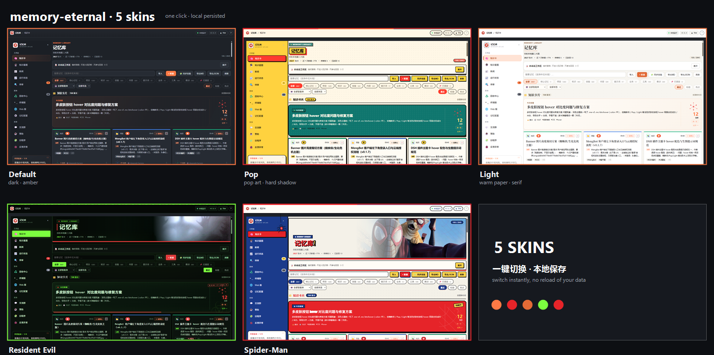
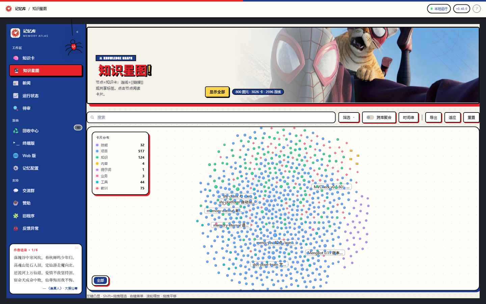
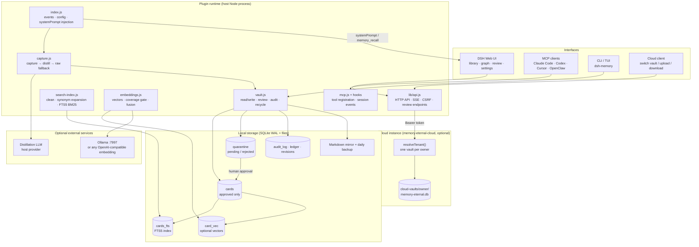
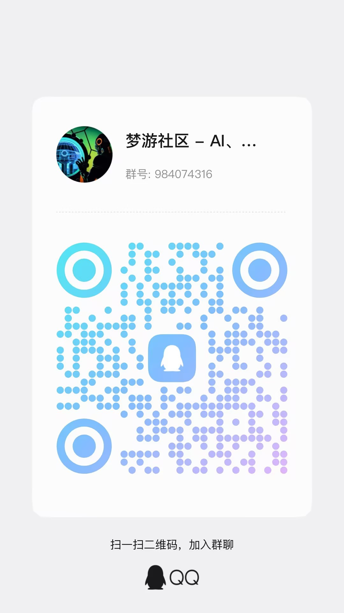

# 🧠 memory-eternal — a second brain for your AI

<p align="center"></p>

<p align="center"></p>

<p align="center">
  
  
  
  
</p>

**English** · [简体中文（默认）](README.md)

## ☁️ Cloud memory (the v0.49.0 headline)

**Your vault follows you, not the machine.** The local vault still works offline; sign in to your cloud instance
and the same cards are readable from every device and every agent — no migration on a new laptop, no re-feeding
context to a new client.

| Capability | What you get |
|---|---|
| **One sign-in** | MengBot account (QR / email OTP) or an access key (`me_…`) issued on any instance |
| **One vault per user** | The cloud instance shards by owner — **each user gets an isolated SQLite file** (`cloud-vaults/{owner}/memory-eternal.db`) |
| **Hot vault switch** | Local ↔ cloud without a restart (`POST /vaults/switch`): cards, graph, review queue, recycle bin and stats all re-source at once, no page reload |
| **Upload / download** | Whole-vault copy (local → cloud, cloud → local) with chunked transfer, **resumable uploads**, cancel mid-flight, 3 retries, and duplicate-skip |
| **Offline first** | An unreachable cloud trips a circuit breaker and falls back to the local vault within 3 s; local memory is untouched |
| **Your own instance** | Self-host `memory-eternal-cloud` (systemd / Docker + HTTPS reverse proxy); keys are issueable, revocable and stored as sha256 only |
| **Three ways to issue keys** | **CLI** (`dsh-memory cloud keys issue` — no admin token needed on the host) · **panel** "🔑 Server key management" · curl; the admin token is auto-generated on first boot |

```bash
# 1) start a cloud instance (off by default; without it you are purely local)
MEMORY_CLOUD=1 node lib/web.js --port 7999     # Docker / systemd recipe: docs/CLOUD.md
# first boot auto-generates the admin token -> $DSH_HOME/cloud-admin-token (0600, printed once)

# 2) issue an access key (pick one)
dsh-memory cloud keys issue --owner alice --note laptop   # CLI: shell access = admin, no token, effective immediately
# or: panel -> Settings -> 🧪 Experimental -> Cloud connection -> "🔑 Server key management" -> paste admin token -> New
curl -X POST http://127.0.0.1:7999/memory-eternal/api/cloud/keys \
  -H "Authorization: Bearer $MEMORY_CLOUD_ADMIN_TOKEN" \
  -H 'Content-Type: application/json' -d '{"owner":"alice"}'

# 3) panel: Settings -> 🧪 Experimental -> Cloud connection -> URL + key -> [Test] -> [Save & switch]
```

> Behind a reverse proxy or in a container, set two variables: `MEMORY_CLOUD_ADMIN_TOKEN` (used if set; otherwise the auto-generated token on disk wins) and `MEMORY_PUBLIC_HOST` (Host allowlist for write requests — put your domain there).
> Boundary: the cloud server (multi-tenant + auth + billing hooks) is a **separate private component** and is not
> shipped with this open-source package; those endpoints are still moving fast and may shift. Ignore the cloud
> entirely and everything behaves exactly as before — see [docs/CLOUD.md](docs/CLOUD.md) and [docs/PRIVATE.md](docs/PRIVATE.md).

## 📊 How it compares — measured, not advertised

> Data date **2026-11-15**: stars come from the GitHub API (raw integers); public scores are transcribed from each
> project's own README / paper **in their own metric**, and metrics are never mixed in one column. Visual version:
> [bench/comparison.html](bench/comparison.html); methodology and repro scripts: [bench/COMPARISON.md](bench/COMPARISON.md).

**Table 1 · Memory class: overall judgement (10 weighted dimensions, our own rubric)**

| Rank | Project | Recall | Semantics | Privacy | Governance | Cost | Total |
|---|---|---|---|---|---|---|---|
| 🥇 1 | **memory-eternal (Ollama)** | 8.6 | 8.6 | 9.5 | 9.0 | 8.0 | **8.54** |
| 🥈 2 | **memory-eternal (built-in)** | 7.1 | 6.8 | 9.5 | 9.0 | 9.5 | **8.48** |
| 🥉 3 | Mem0 (69.0k★) | 9.3 | 9.0 | 6.0 | 6.0 | 6.5 | 7.49 |
| 4 | MemOS (12.4k★) | 8.5 | 8.5 | 7.0 | 6.0 | 7.0 | 7.38 |
| 5 | graphiti (32.8k★) | 7.8 | 8.5 | 8.0 | 6.0 | 7.0 | 7.26 |
| 6 | basic-memory (4.6k★) | 6.5 | 6.5 | 9.0 | 6.0 | 9.0 | 7.26 |
| 7 | Letta (25.4k★) | 8.0 | 8.5 | 8.0 | 6.0 | 6.5 | 7.22 |
| 8 | mcp-memory-service (2.1k★) | 6.0 | 6.0 | 9.0 | 5.0 | 9.5 | 7.17 |
| 9 | memobase (3.0k★) | 7.2 | 7.0 | 8.0 | 6.0 | 8.0 | 7.15 |
| 10 | cognee (33.3k★) | 8.0 | 8.5 | 8.0 | 5.5 | 7.0 | 7.14 |
| 11 | supermemory (31.6k★) | 8.0 | 8.0 | 6.5 | 5.5 | 6.5 | 7.14 |
| 12 | Zep (5.0k★, closed product) | 7.0 | 7.5 | 6.5 | 6.5 | 6.0 | 6.88 |

**Table 2 · Memory class: public benchmarks and deployment hard facts**

| Project | Stars | Public score (as reported) | Local / zero API | Human review gate |
|---|---|---|---|---|
| **memory-eternal (bge-m3)** | 176 | **R@5 97.2%** on our own 500-question set (retrieval) | needs Ollama | ✅ |
| **memory-eternal (built-in)** | 176 | **R@5 95.4%** on our own 500-question set (retrieval) | ✅ / ✅ | ✅ |
| Mem0 | 68,996 | LongMemEval 94.4 (**managed platform** figure, not the OSS build) | partial | weak |
| cognee | 33,321 | BEAM 100K 0.79 / BEAM 10M 0.67 (0–1 scale) | partial | medium |
| graphiti | 32,814 | no LongMemEval / LoCoMo number in the repo | partial | medium |
| supermemory | 31,628 | LongMemEval **R@15 95%** (~720 tokens) | partial | weak |
| Letta ※ | 25,445 | no LongMemEval / LoCoMo number in the repo | partial | medium |
| MemOS | 12,403 | LongMemEval 89.20 (OmniMemEval) | partial | medium |
| Zep ※ | 5,007 | paper: LongMemEval accuracy **+18.5%** over MemGPT, −90% latency | ❌ | medium |
| basic-memory | 4,577 | no public memory benchmark number | ✅ / ✅ | weak |
| memobase | 2,958 | LoCoMo 75.78 (third-party reproduction, LLM-Judge overall) | partial | medium |
| mcp-memory-service | 2,127 | LongMemEval-S **R@5 86.0%** with zero LLM calls | ✅ / ✅ | weak |

> ※ **Status that has to be stated**: `getzep/zep` is a samples/integrations repo for Zep Cloud — the product itself is
> closed source (the open graph engine is graphiti). `letta-ai/letta` is archived with active source in `letta-code`.
> Neither star count should be read as "the open-source build".

## ⚡ Quick start

```bash
# DSH desktop / web
dsh plugin --profile desktop add memory-eternal     # reopen DSH -> sidebar "Memory"

# Same vault for Claude Code / Codex / Cursor (MCP)
npm i -g memory-eternal && dsh-memory connect claude

# Any MCP client (MengBot / OpenClaw / Hermes: docs/INTEGRATIONS.md)
npx -y -p memory-eternal dsh-memory mcp

# Browser / terminal
dsh-memory open                             # http://127.0.0.1:7999
npx -y -p memory-eternal dsh-memory tui     # live review queue in the terminal
```

<p align="center"><strong>⭐ If it saves you from explaining the same context again, a star helps a lot.</strong></p>

## 🧾 Does it actually save tokens?

Most memory products <em>say</em> they save tokens. We think you should check. The plugin ships a built-in **memory ledger** (Runtime status → Memory ledger):

| Recorded | What it means |
|---|---|
| recall: hits + injected characters | how much memory actually entered the context |
| capture: LLM calls + input/output characters | what distillation cost you |
| usefulness: useful / not-useful feedback | whether recalled memories actually helped |

```text
net benefit ≈ avoided context cost − (injected characters + distillation calls × price)
```

| Scenario | You pay | You avoid |
|---|---|---|
| Multi-session project with decisions and pitfalls | ~0.6–0.9k tokens per recall | re-explaining context (~1.5–3k) or re-reading files (3–6k) |
| One-off question, low hit rate | recall injection | usually nothing |

> Illustrative numbers, not a benchmark — measure your own with the ledger. If recall usefulness stays below ~60%, tune it down or turn memory off.
> Once you are on the cloud, the ledger is per vault: local and cloud count separately, one statistic per vault.

## 🛡️ Review first, prove later

A memory system that silently ingests everything will eventually recall a wrong fact as truth. memory-eternal defaults to **review-before-commit**:

- new cards land in a **pending queue**; nothing enters the main vault until a human approves it;
- approve, reject or bulk-process from the Web UI, the terminal TUI, or the CLI;
- every status change is appended to an **immutable audit log** (who / what / when / why) — enforced at the SQLite layer, not by convention;
- agents can read and propose, but **cannot approve their own cards**;
- agents can also submit a **revision**: a copy of an approved card lands in the queue marked "✏️ revision of …"; approving it overwrites the original, rejecting it leaves the original untouched;
- deleted cards go to a recycle bin (30 days by default).

> The cloud keeps the same gate: switching to a cloud vault only swaps the **data source**, never the rules —
> pending cards on the cloud still need a human approval.

## ⭐ Core memory

Not everything should be injected into every session. Core memory is the small, explicit set of rules and preferences that must always win:

- any approved card can be promoted from the reader or card list;
- auto-capture may **suggest** core only for explicit long-term preferences / hard constraints, and core candidates always stay pending for review;
- approved core cards are injected into the system prompt of every session — no `memory_recall` call needed;
- set a card limit and character budget in Settings → Memory → Core memory;
- in the knowledge graph, core nodes are orange diamonds with a ★;
- never store secrets or API keys in a core card; keep only a pointer to the credential directory.


## 🧩 Supported hosts (one vault, every host)

One SQLite vault that all of the following can read from and write to. Every write lands in the **review queue**; approving happens in the DSH / Web panel, regardless of which host wrote the card.

- **DeepSeek Harness (desktop / `dsh web`)** — plugin: `dsh plugin --profile desktop add memory-eternal`; full embedded panel (review · graph · ledger · cloud switcher · key management).
- **Claude Code** — MCP: `dsh-memory connect claude`; auto-capture on session end (user-level hook).
- **Codex / Codex Desktop** — MCP: `dsh-memory connect codex`; same, no plugin required.
- **Cursor** — MCP: `dsh-memory connect cursor`; plus the [Cursor / VS Code extension](cursor-extension/README.md).
- **MengBot** — MCP (per bot): add one stdio server to the bot's MCP config, `npx -y -p memory-eternal dsh-memory mcp`; one vault per bot or a shared one — see [INTEGRATIONS](docs/INTEGRATIONS.md).
- **OpenClaw** — MCP: add one stdio server under `mcp.servers`, verify with `openclaw mcp doctor memory-eternal --probe`.
- **Hermes Agent (NousResearch)** — MCP: add one entry under `mcp_servers` in `~/.hermes/config.yaml`; tools are discovered on start.
- **WorkBuddy and any other MCP client** — MCP: standard stdio, `command: npx` / `args: ["-y","-p","memory-eternal","dsh-memory","mcp"]`.
- **Terminal (TUI)** — `npx -y -p memory-eternal dsh-memory tui`: live queue, select-all, batch approve/reject, long-form reader.
- **Web** — `dsh-memory open` → http://127.0.0.1:7999: standalone; review, search and backup without any host.
- **Orca launcher** — see [orca-plugin](orca-plugin/README.md): launches with the vault already attached.
- **Cloud instance** — same API over HTTPS after sign-in (see "Cloud memory" above); the local vault is your offline copy.

> MCP is just a standard stdio server with 5 tools: `memory_recall` / `memory_capture` / `memory_stats` / `memory_audit_list` / `memory_revise`. Anything not listed works with the same stdio snippet.


**We are not the biggest here.** Mem0 has 69k stars and a funded team. What we do differently is the
**write path**: a human gate, physically separated stores, an audit trail you can point at, plus a ledger so you can
check whether recall is actually worth its cost — that is the "governance" column in Table 1, not a tagline.

Reproduce the numbers on **your own vault**:

```bash
node scripts/bench-search.mjs --rebuild   # rebuild time + p50/p95/max latency
node scripts/bench-recall.mjs             # golden-set R@5 / Top1
dsh-memory ledger --days 30 --json        # recall injection / capture calls / usefulness
```

| Our measured baseline (2026-11-12, 2,943 cards) | Value |
|---|---|
| Golden 109 R@5 (built-in / bge-m3) | 96.3% / **99.1%** |
| Golden 109 Top1 (built-in / bge-m3) | 86.2% / **89.9%** |
| Paraphrase 10 R@5 (built-in / bge-m3) | 40% / **70%** |
| LongMemEval-S 500 R@5 (built-in / bge-m3) | 95.4% / **97.2%** |
| Recall latency (lexical / semantic) | ~7 ms / 81 ms |
| Recall model calls (built-in) | 0 |

> Retrieval ≠ QA. Our two rows in Table 2 are **retrieval R@5**; Mem0's 94.4 is a self-reported **LongMemEval QA**
> number on their managed platform. The columns are not comparable.

## 🔍 Semantic recall (built-in by default, no model required)

**Fresh installs use built-in semantics**: zero install, zero network, zero cost; synonym expansion as the semantic fallback. Three deployment modes:

| Mode | Notes |
|---|---|
| Built-in (default) | Zero dependencies; R@5 96.3% on our set, paraphrase 40% |
| Local Ollama (recommended upgrade) | bge-m3 vectors; R@5 99.1%, paraphrase 70%, ~100 ms |
| Online API | OpenAI-compatible endpoint, pay per call |

The first visit to the memory page runs a 3-step guide with everything on by default: memory core / auto-capture / auto-recall / core-memory injection / working memory / built-in semantics. Re-open it from **🧭 Guide** in Settings → Semantic recall. Details: [docs/EMBEDDINGS.md](docs/EMBEDDINGS.md).

## 🎨 Skins & UI

Five skins, switch in Settings → General → Theme with one click. The choice is saved locally and survives reloads.

<p align="center">
  
</p>

| Skin | Style |
|---|---|
| **Default** | Dark base + amber accent, easy on the eyes |
| **Pop** | Yellow paper, black frames, hard shadows and halftone |
| **Light** | Warm paper + serif headings for daytime |
| **Resident Evil** | Umbrella lab, toxic-green scanlines, B.O.W. banner and claw |
| **Spider-Man** | Red/blue comic, webs, halftone, wide action banner and hanging charm |

<p align="center">
  
  
</p>
<p align="center"><sub>▲ Cards · Knowledge graph — <a href="https://eternalnight996.github.io/memory-eternal/demo/">live demo</a></sub></p>

## 🏗 Architecture: one vault, one gate, two read paths



The diagram is only true because three invariants are enforced in code, not by convention:

| Invariant | Enforced by |
|---|---|
| The main store **only** ever contains approved cards | Two physical tables; every read path queries the main one |
| An agent can never approve its own memory | Agent writes land in quarantine; approve/reject is a human action in the UI / TUI / CLI |
| Recall costs **zero model calls** | FTS5 + BM25; the LLM runs only while distilling |

> The cloud adds exactly one edge: `API → resolveTenant() → that owner's own vault`. No shared tables between tenants, so data cannot leak across.

## 🔗 MEM Pair: pair two vaults, exchange cards (v0.49.0)

You often run several memory-eternal instances side by side: the ops vault (7999), an isolated mem-purge (7989),
and a cloud instance. Each has its own SQLite, so they **must not share one vault** — yet you do want them to feed
each other (ops conventions → purge, purge findings → ops).

MEM Pair is that channel: explicit, auditable, and quiet by default.

| Step | How | Signal |
|---|---|---|
| Discover | LAN UDP broadcast (7990 by default), or type `host:port` | Panel lists the peer name, **pair code** and fingerprint |
| First pairing | One side starts it → the other side gets a **dialog** (6-digit handshake code, compared by eye) | Both sides list the peer |
| Reconnect | **The pair code alone is enough**: if the peer knows the code and the fingerprint is unchanged, it connects silently | Panel shows "paired → peer" |
| Fingerprint changed | Peer reinstalled, or possibly impersonated → back to manual confirmation, dialog flagged red | You confirm again |
| Move data | "Upload" (this vault → peer) / "Download" (peer → this vault); everything lands in the **peer's review queue** | Counts: sent / written / failed |

```bash
dsh-memory peer code                                  # my pair code
dsh-memory peer pair 192.168.1.20:7989                # first pairing (peer confirms)
dsh-memory peer connect 7K2M-Q9FA --host 192.168.1.20 --port 7989   # afterwards, code only
dsh-memory peer upload   --to 7K2M-Q9FA               # push cards (peer reviews them)
dsh-memory peer download --from 7K2M-Q9FA             # pull cards (this vault reviews them)
```

Security: the shared secret is derived independently on both ends from one-time ephemerals (long-term keys never travel);
every call is HMAC-signed with a ±5 min window and nonce de-dup; anything a peer sends lands in **review only**.

## 🔌 Agent MCP mounting (one standard, six hosts)

**Installed as a DSH plugin, the MCP server is mounted to DSH itself by default** (`~/.dsh/mcp-servers.json`) — usable
right away. Claude Code / Codex / Cursor / Windsurf are hosts *you* open separately, so they **must be mounted by hand** —
otherwise several agents in one repo read different vaults and their captures get mixed up.

All hosts share one standard (declare once, render everywhere): the server name is always `memory-eternal`, stdio only,
absolute paths, parameters via `env`, idempotent writes that **only touch our own entry**, read-back verification, and
drift detection when the entry still points at an old package path.

```bash
dsh-memory mcp status                                   # status + per-host matrix
dsh-memory mcp mount --vault ~/.dsh/memory-vault        # local vault (writes DSH by default)
dsh-memory mcp mount --url http://127.0.0.1:7989 --host dsh,claude   # project into several hosts
dsh-memory mcp mount --vault <vault> --host all         # every installed host
dsh-memory mcp unmount                                  # remove from all mounted hosts (idempotent)
```

Panel: **Settings → 🧪 Experimental → 🔌 Agent MCP mount** (one row per host + target picker + mount/unmount + drift warning).
To turn auto-mounting off entirely: config `mcpAutoMount: false`, or env `MEMORY_MCP_AUTOMOUNT=0`.

## 📚 Documentation & links

- [Full manual (English)](docs/GUIDE.md) · [完整手册（中文）](docs/GUIDE.zh-CN.md)
- [Cloud multi-tenancy & deployment](docs/CLOUD.md) · [Self-hosting (Docker / systemd)](docs/DEPLOY.md) · [Private component boundary](docs/PRIVATE.md)
- [Changelog](docs/CHANGELOG.md) · [Architecture notes](docs/ARCHITECTURE.md) · [UI skins](docs/UI-SKINS.md)
- [Terminal plugin (dsh-tui)](dsh-tui-plugin/README.md) · [Orca launcher](orca-plugin/README.md) · [Cursor / VS Code extension](cursor-extension/README.md)
- [Report a bug](https://github.com/EternalNight996/memory-eternal/issues)

## 💬 Community

**Questions, ideas, or DSH plugin talk — join the groups:**

| QQ group | WeChat group |
|:---:|:---:|
|  |  |

**Buy the author a coffee (optional) — WeChat or Alipay:**

| WeChat Pay | WeChat Reward | Alipay |
|:---:|:---:|:---:|
|  |  |  |

> Sponsorship is optional; the plugin stays MIT and free. See [SPONSOR.md](SPONSOR.md).

## 📄 License

MIT — use it, self-host it, build on it.

## 🖋 Author's Quotes

_Verses from 《蛊真人》(Reverend Insanity). Kept in the original Chinese — a translation would lose the meter. Also rotating at the bottom of the panel's left rail._

> 落魄谷中寒风吹，春秋蝉鸣少年归。<br>
> 荡魂山处石人泪，定仙游走魔向北。<br>
> 逆流河上万仙退，爱情不敌坚持泪。<br>
> 宿命天成命中败，仙尊悔而我不悔。

> 早岁已知世事艰，仍许飞鸿荡云间。

> 男儿不展凌云志，空负天生八尺躯。

> 天河一挂淘龙鱼，逆天独行顾八荒。<br>
> 今朝暂且展翼去，明朝飞仙笞凤凰！

<p align="right"><sub>——《蛊真人》· 大爱仙尊</sub></p>

## 🌟 Contributors

Thanks to everyone who helped memory-eternal get better.

| Contributor | Contribution |
| --- | --- |
| [@aloneangel45](https://github.com/aloneangel45) | Found and fixed [#54](https://github.com/EternalNight996/memory-eternal/issues/54) — `memory_recall` / `memory_note` were never registered when the `tools` service mounted late ([#58](https://github.com/EternalNight996/memory-eternal/pull/58)) |
| [@EternalNight996](https://github.com/EternalNight996) | Author and maintainer |

Have a fix worth landing? Open an issue or a pull request — accepted contributions are listed here.
