# 🧠 memory-eternal — a second brain for your AI

<p align="center"></p>

<p align="center">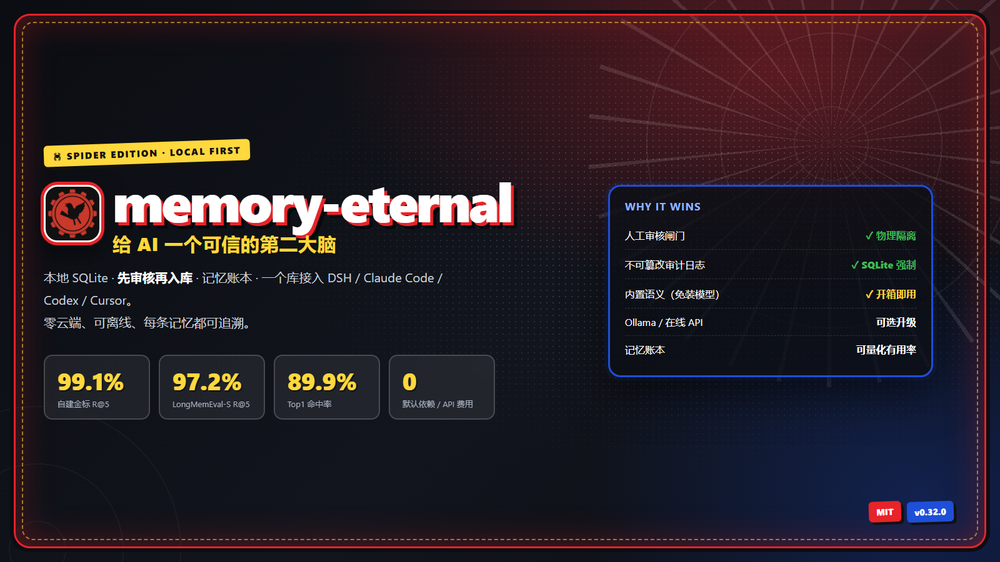</p>

## 📊 Benchmarks (2026-11-12)

| Rank | Variant | Golden 109 R@5 | LongMemEval-S R@5 | Top1 | Dependencies |
|---|---|---|---|---|---|
| 🥇 | **Ollama (bge-m3)** | **99.1%** | **97.2%** (500 Qs, full) | **89.9%** | local model |
| 🥈 | **Built-in semantics (default)** | 96.3% | 95.4% (500 Qs, full) | 86.2% | **zero** |
| 🥉 | Mem0 (reference) | — | 94.4% (QA score) | — | cloud / model |

> 10-dimension score: **8.54 / 8.48**, top tier (OMEGA 8.47). Full ranking, deployment and cost: **[comparison page](bench/comparison.html)**.
> Retrieval ≠ QA; the two columns are not compared across. Paraphrase R@5 40% → **70%**, noisy-query Top1 60% → **95%**.

<p align="center">
  
  
  
  
</p>

**English** · [简体中文（默认）](README.md)

## 📸 UI (Spider-Man skin)

<p align="center">
  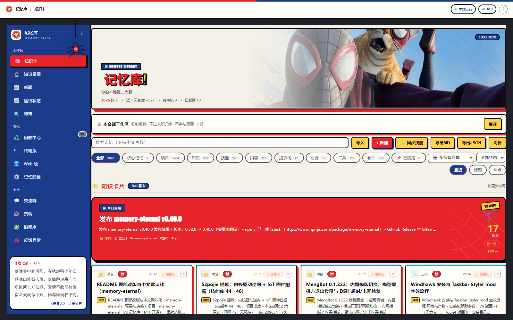
  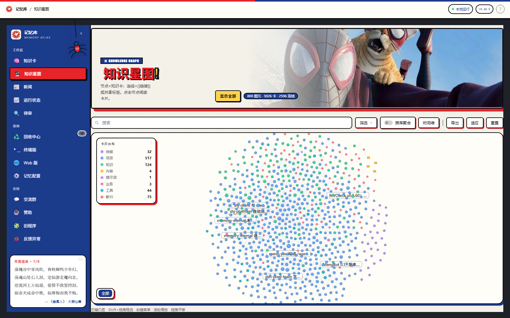
</p>
<p align="center">
  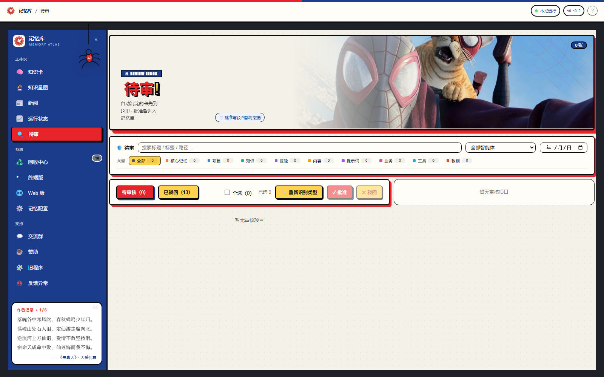
  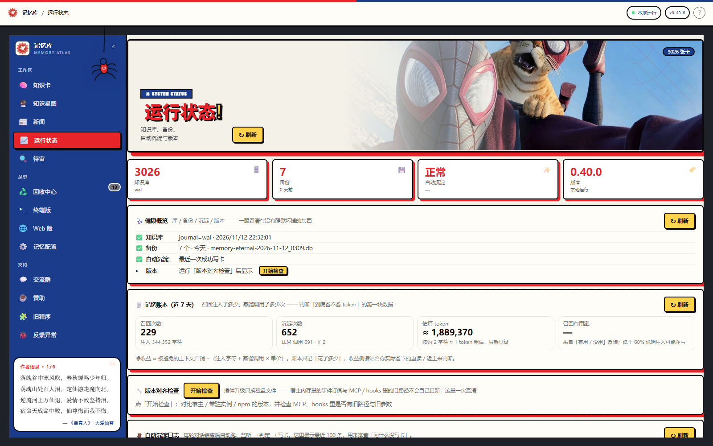
</p>

**memory-eternal** — a long-term memory your AI cannot forget, can be audited, and can be measured. Local-first · review-gated · token ledger · one vault shared by DSH, Claude Code, Codex, Cursor and any MCP client.

> **Your AI forgets every session. Give it a memory it can trust.**
>
> Local-first, review-gated, measurable — one SQLite vault shared by DSH, Claude Code, Codex, Cursor and any MCP client.

- 🔍 **Review before it counts** — new cards wait in a review queue; approve or reject from the Web UI or terminal; every change is written to an immutable audit log.
- ✏️ **Editable & revisable** — fix a card by hand in the reader, or let an agent submit a **revised copy** (`memory_revise`); the queue labels it a revision, and an approved card is only overwritten when you approve it.
- 🧾 **Token ledger** — see how much recall injected, how many distillation calls ran, and how often recall was actually useful.
- 🏠 **Local-first, no cloud** — SQLite + Markdown on your own disk. No third-party memory framework, no account. Memory data never leaves the machine; only the News page fetches public RSS / Hacker News on demand (titles, excerpts and outbound links only).
- ⭐ **Core memory** — promote approved cards to always-on memory; every session gets them automatically, and the review queue still decides what qualifies.
- 🧭 **Reader & layout** — clickable table of contents in the card reader, plus a compact / normal / large layout setting for the whole memory UI.

<p align="center"><strong>⭐ If it saves you from explaining the same context again, a star helps a lot.</strong><br/><sub>DSH one-liner: <code>dsh plugin --profile desktop add memory-eternal</code></sub></p>

## ⚡ Quick start

**DeepSeek Harness (desktop / web)**

```bash
dsh plugin --profile desktop add memory-eternal
# reopen DSH → sidebar "Memory"
```

**Claude Code, Codex or Cursor — same vault via MCP**

```bash
npm i -g memory-eternal
dsh-memory connect claude    # or: codex / cursor
```

**Any MCP client**（MengBot / OpenClaw / Hermes 见 [docs/INTEGRATIONS.md](docs/INTEGRATIONS.md)）

```bash
npx -y -p memory-eternal dsh-memory mcp
```

**Browser or terminal**

```bash
dsh-memory open              # http://127.0.0.1:7999
npx -y -p memory-eternal dsh-memory tui   # live queue in the terminal
```

## 🧬 How memory actually flows

One SQLite vault, one write gate, two read paths. Nothing enters recall without passing the gate.

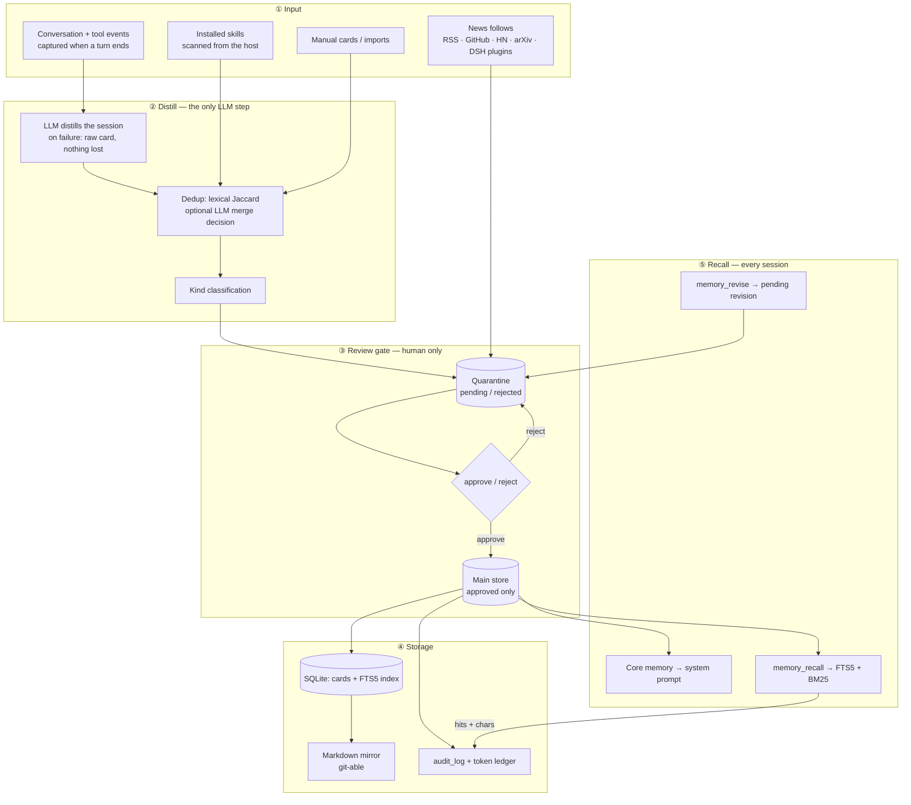

The diagram is only true because three invariants are enforced in code, not by convention:

| Invariant | Enforced by |
|---|---|
| The main store **only** ever contains approved cards | Two physical tables; every read path queries the main one |
| An agent can never approve its own memory | Agent writes land in quarantine; approve/reject is a human action in the UI / TUI / CLI |
| Recall costs **zero model calls** | FTS5 + BM25; the LLM runs only while distilling |

## 🏗 Full architecture

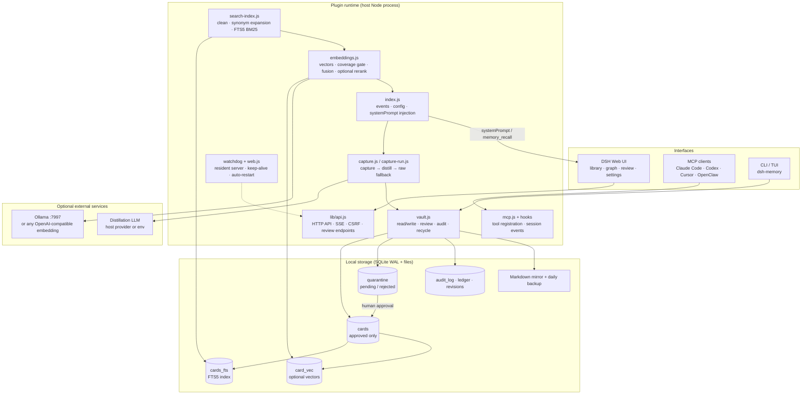

Three layers: **interfaces** only render and call; **runtime** does capture, retrieval, review and injection; **storage** physically separates approved from pending, with Markdown as a readable mirror. Only two optional external dependencies exist — the distillation LLM and the embedding service — and both can be turned off.

## 🔌 How agents talk to the memory

| Channel | Direction | When | Gate | Cost |
|---|---|---|---|---|
| `memory_recall` | agent → memory | on demand | approved only | **0 model calls** (p50 2.3 ms) |
| Core memory | memory → agent | every session, automatic | approved only | ~0.2k chars |
| Session capture / `memory_write` | conversation → memory | turn end | **queued for review** | 1 LLM call |
| `memory_revise` | agent → memory | on demand | **queued as a revision** | 0 |
| Review (Web UI · TUI · CLI) | human → memory | manual | — | 0 |
| Hooks (Claude Code / Codex / Cursor) | host → memory | session end | **queued** | 1 LLM call |
| MCP server | any MCP client | on demand | same gate | same |
| News follows | web → memory | interval / 24h | isolated from cards | network only |

## 🧾 Does it actually save tokens?

Most memory products <em>say</em> they save tokens. We think you should check. The plugin ships a built-in **memory ledger** (Runtime status → Memory ledger) that records:

| Recorded | What it means |
|---|---|
| recall: hits + injected characters | how much memory actually entered the context |
| capture: LLM calls + input/output characters | what distillation cost you |
| usefulness: useful / not-useful feedback | whether recalled memories actually helped |

The honest math:

```text
net benefit ≈ avoided context cost − (injected characters + distillation calls × price)
```

| Scenario | You pay | You avoid |
|---|---|---|
| Multi-session project with decisions and pitfalls | ~0.6–0.9k tokens per recall | re-explaining context (~1.5–3k) or re-reading files (3–6k) |
| One-off question, low hit rate | recall injection | usually nothing |

> Illustrative numbers, not a benchmark — measure your own with the ledger. If recall usefulness stays below ~60%, tune it down (fewer results, shorter summaries) or turn memory off.

## 📊 How it compares — measured on a real vault

> Only recognisable GitHub projects (picked by stars); two tables, top three 🥇🥈🥉. Styled version: [bench/comparison.html](bench/comparison.html).

**Table 1 · Overall ranking (10 weighted dimensions, judgement score)**

| Rank | Project | Recall | Semantics | Privacy | Governance | Cost | Total |
|---|---|---|---|---|---|---|---|
| 🥇 1 | **memory-eternal (Ollama)** | 8.6 | 8.6 | 9.5 | 9.0 | 8.0 | **8.54** |
| 🥈 2 | **memory-eternal (built-in)** | 7.1 | 6.8 | 9.5 | 9.0 | 9.5 | **8.48** |
| 🥉 3 | Mem0 (68.8k★) | 9.3 | 9.0 | 6.0 | 6.0 | 6.5 | 7.49 |
| 4 | MemOS (12.4k★) | 8.5 | 8.5 | 7.0 | 6.0 | 7.0 | 7.38 |
| 5 | graphiti (32.8k★) | 7.8 | 8.5 | 8.0 | 6.0 | 7.0 | 7.26 |
| 6 | basic-memory (4.6k★) | 6.5 | 6.5 | 9.0 | 6.0 | 9.0 | 7.26 |
| 7 | Letta (25.4k★) | 8.0 | 8.5 | 8.0 | 6.0 | 6.5 | 7.22 |
| 8 | mcp-memory-service (2.1k★) | 6.0 | 6.0 | 9.0 | 5.0 | 9.5 | 7.17 |
| 9 | memobase (3.0k★) | 7.2 | 7.0 | 8.0 | 6.0 | 8.0 | 7.15 |
| 10 | cognee (33.3k★) | 8.0 | 8.5 | 8.0 | 5.5 | 7.0 | 7.14 |
| 11 | supermemory (31.6k★) | 8.0 | 8.0 | 6.5 | 5.5 | 6.5 | 7.14 |
| 12 | Zep (5.0k★) | 7.0 | 7.5 | 6.5 | 6.5 | 6.0 | 6.88 |

**Table 2 · Public benchmarks and deployment hard facts**

| Rank | Project | LongMemEval QA | Retrieval R@5 | Local / zero API | Governance | Stars |
|---|---|---|---|---|---|---|
| 🥇 1 | memory-eternal (Ollama) | not run | **97.2%** (500 Qs) | needs Ollama | ✅ | 176 |
| 🥈 2 | memory-eternal (built-in) | not run | **95.4%** (500 Qs) | ✅ / ✅ | ✅ | 176 |
| 🥉 3 | Mem0 | 94.4% | — | partial | weak | 68,849 |
| 4 | MemOS | — | — | partial | medium | 12,366 |
| 5 | graphiti | — | — | partial | medium | 32,771 |
| 6 | basic-memory | — | — | ✅ / ✅ | weak | 4,557 |
| 7 | Letta | — | — | partial | medium | 25,421 |
| 8 | mcp-memory-service | — | 80.4–86.0% | ✅ / ✅ | weak | 2,116 |
| 9 | memobase | — | — | partial | medium | 2,956 |
| 10 | cognee | — | — | partial | medium | 33,263 |
| 11 | supermemory | 81.6–85.2% | — | partial | weak | 31,595 |
| 12 | Zep | 71.2% | — | ❌ | medium | 5,005 |

**We are not the biggest here.** Mem0 has 68.8k stars, a funded team and a managed service; what we do differently is the *write path*: a human gate, a three-store separation, an audit trail you can point at — plus a token ledger so you can check whether recall is worth its cost. The 97.2% / 95.4% in Table 2 is **retrieval R@5**, not QA; OMEGA 95.4% and Hindsight 91.4% are self-reported QA, shown for reference only.

Reproduce our numbers on your own vault:

```bash
node scripts/bench-search.mjs --rebuild   # rebuild time + p50/p95/max latency
dsh-memory ledger --days 30 --json        # recall injection / capture / usefulness
```

| Our measured baseline (2026-11-12) | Value |
|---|---|
| Cards in vault | 2,943 |
| Golden 109 R@5 (built-in / bge-m3) | 96.3% / **99.1%** |
| Golden 109 Top1 (built-in / bge-m3) | 86.2% / **89.9%** |
| Paraphrase 10 R@5 (built-in / bge-m3) | 40% / **70%** |
| LongMemEval-S 500 R@5 (built-in / bge-m3) | 95.4% / **97.2%** |
| Recall latency (lexical / semantic) | ~7 ms / 81 ms |
| Recall model calls (built-in) | 0 |

## 🛡️ Review first, prove later

A memory system that silently ingests everything will eventually recall a wrong fact as truth. memory-eternal defaults to **review-before-commit**:

- new cards land in a **pending queue**; nothing enters the main vault until a human approves it;
- approve, reject or bulk-process from the Web UI, the terminal TUI, or the CLI;
- every status change is appended to an **immutable audit log** (who / what / when / why) — enforced at the SQLite layer, not by convention;
- agents can read and propose, but **cannot approve their own cards**;
- agents can also submit a **revision**: a copy of an approved card lands in the queue marked “✏️ revision of …”; approving it overwrites the original (id, path and status preserved, an entry appended to the card's update log), rejecting it leaves the original untouched;
- deleted cards go to a recycle bin (30 days by default).

## ⭐ Core memory

Not everything should be injected into every session. Core memory is the small, explicit set of rules and preferences that must always win:

- any approved card can be promoted from the reader or card list;
- auto-capture may **suggest** core only for explicit long-term preferences / hard constraints, and core candidates always stay pending for review;
- approved core cards are injected into the system prompt of every session — no `memory_recall` call needed;
- set a card limit and character budget in Settings → Memory → Core memory;
- in the knowledge graph, core nodes are orange diamonds with a ★;
- never store secrets or API keys in a core card; keep only a pointer to the credential directory.

## 🎛 Reader & layout

- click any heading in the reader's table of contents to smoothly scroll to that section;
- Settings → Memory → Layout size offers **compact / normal / large** for the whole UI; it only affects display.

## 🧩 One vault, every agent

| Entry | What you get |
|---|---|
| **DSH desktop / web** | embedded memory UI: review, graph, config, ledger |
| **Claude Code / Codex / Cursor** | MCP server, same local vault, <code>dsh-memory connect</code> |
| **Any MCP client** | <code>npx -y -p memory-eternal dsh-memory mcp</code> |
| **Terminal** | <code>dsh-memory tui</code> — live queue, select-all, batch approve/reject, long-form reader |
| **Browser** | <code>dsh-memory open</code> → http://127.0.0.1:7999 |

## 🎨 Skins

Five skins, switch in Settings → General → Theme with one click. The choice is saved locally and survives reloads.

<p align="center">
  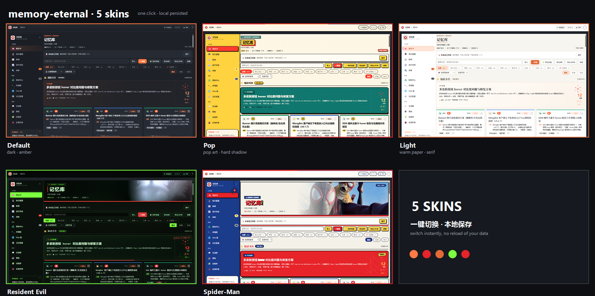
</p>

| Skin | Style |
| --- | --- |
| **Default** | Dark base + amber accent, easy on the eyes |
| **Pop** | Yellow paper, black frames, hard shadows and halftone |
| **Light** | Warm paper + serif headings for daytime |
| **Resident Evil** | Umbrella lab, toxic-green scanlines, B.O.W. banner and claw |
| **Spider-Man** | Red/blue comic, webs, halftone, wide action banner and hanging charm |

## 📸 Screenshots

<p align="center">
  <a href="https://eternalnight996.github.io/memory-eternal/demo/">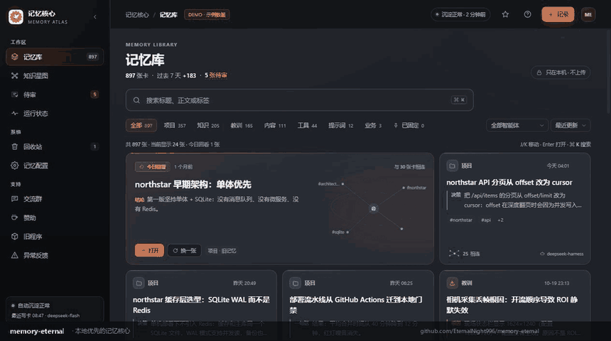</a>
</p>
<p align="center"><sub>▲ 20-second tour — review queue · token ledger · knowledge graph · <a href="https://eternalnight996.github.io/memory-eternal/demo/">live demo</a></sub></p>


<p align="center">
  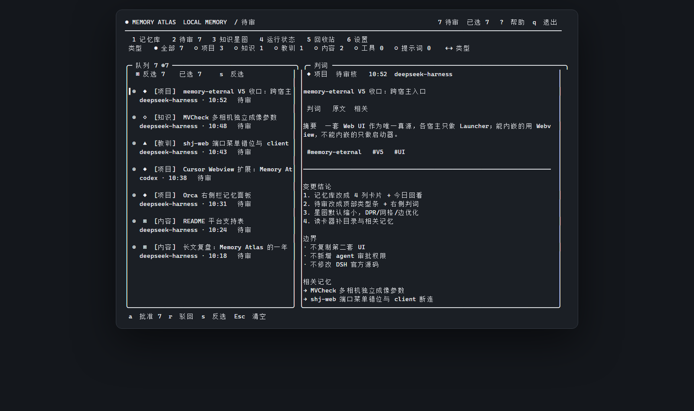
  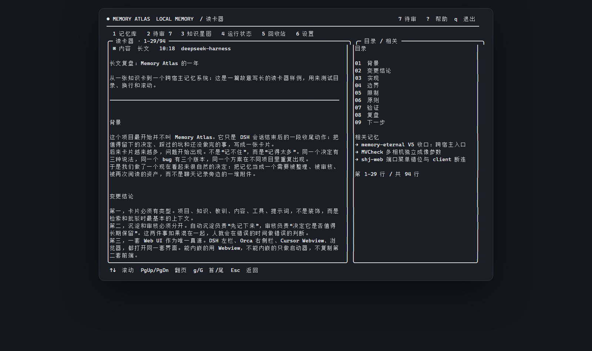
</p>
<p align="center"><sub>▲ Terminal-native review and long-form reading — <code>dsh-memory tui</code></sub></p>

## 🔍 Semantic recall (built-in by default, no model required)

**Fresh installs use built-in semantics**: zero install, zero network, zero cost; synonym expansion as the semantic fallback. Three deployment modes:

| Mode | Notes |
|---|---|
| Built-in (default) | Zero dependencies; R@5 96.3% on our set, paraphrase 40% |
| Local Ollama (recommended upgrade) | bge-m3 vectors; R@5 99.1%, paraphrase 70%, ~100ms |
| Online API | OpenAI-compatible endpoint, pay per call |

The first visit to the memory page runs a 3-step guide with everything on by default: memory core / auto-capture / auto-recall / core-memory injection / working memory / built-in semantics. Re-open it from **🧭 Guide** in Settings → Semantic recall.

Ollama upgrade: install, set `OLLAMA_HOST=127.0.0.1:7997`, run `ollama serve`, then “pull model → deploy” in the panel.

**Measured (2026-11-12)**: our 109-question set — built-in R@5 96.3%, Top1 86.2%; with bge-m3 R@5 **99.1%**, Top1 89.9%.
LongMemEval-S (500 questions, full set): lexical 95.2%, semantic **97.2%** R@5 (retrieval metric, not QA).

Details: [docs/EMBEDDINGS.md](docs/EMBEDDINGS.md) and [bench/FINAL-REPORT.md](bench/FINAL-REPORT.md).

## 📚 Documentation & links

- [Full manual (English)](docs/GUIDE.md) · [完整手册（中文）](docs/GUIDE.zh-CN.md)
- [Private deployment (Docker / systemd)](docs/DEPLOY.md)
- [Changelog](docs/CHANGELOG.md) · [Architecture](docs/ARCHITECTURE.md)
- [Terminal plugin (dsh-tui)](dsh-tui-plugin/README.md) · [Orca launcher](orca-plugin/README.md) · [Cursor / VS Code extension](cursor-extension/README.md)
- [Report a bug](https://github.com/EternalNight996/memory-eternal/issues)

## 💬 Community

**Questions, ideas, or DSH plugin talk — join the groups:**

| QQ group | WeChat group |
|:---:|:---:|
|  |  |

**Buy the author a coffee (optional) — WeChat or Alipay:**

| WeChat Pay | WeChat Reward | Alipay |
|:---:|:---:|:---:|
|  |  |  |

> Sponsorship is optional; the plugin stays MIT and free. See [SPONSOR.md](SPONSOR.md).

## 📄 License

MIT — use it, self-host it, build on it.

## 🖋 Author's Quotes

_Verses from 《蛊真人》(Reverend Insanity). Kept in the original Chinese — a translation would lose the meter. Also rotating at the bottom of the panel's left rail._

> 落魄谷中寒风吹，春秋蝉鸣少年归。<br>
> 荡魂山处石人泪，定仙游走魔向北。<br>
> 逆流河上万仙退，爱情不敌坚持泪。<br>
> 宿命天成命中败，仙尊悔而我不悔。

> 早岁已知世事艰，仍许飞鸿荡云间。

> 男儿不展凌云志，空负天生八尺躯。

> 千古地仙随风逝，昔日三王归青冢。<br>
> 阳莽悍陨谁无败？卷土重来再称王。

> 天河一挂淘龙鱼，逆天独行顾八荒。<br>
> 今朝暂且展翼去，明朝飞仙笞凤凰！

> 独帜入渊深未知，身似浮萍命难持。<br>
> 千舟皆朝归海处，一苇青拨戏浪巅。<br>
> 惊鸿四散鱼逃尽，唯有残帆傲此间。<br>
> 待到天开云雾散，负手直望笑苍天。

<p align="right"><sub>——《蛊真人》· 大爱仙尊</sub></p>

---

## 🌟 Contributors

Thanks to everyone who helped memory-eternal get better.

| Contributor | Contribution |
| --- | --- |
| [@aloneangel45](https://github.com/aloneangel45) | Found and fixed [#54](https://github.com/EternalNight996/memory-eternal/issues/54) — `memory_recall` / `memory_note` were never registered when the `tools` service mounted late ([#58](https://github.com/EternalNight996/memory-eternal/pull/58)) |
| [@EternalNight996](https://github.com/EternalNight996) | Author and maintainer |

Have a fix worth landing? Open an issue or a pull request — accepted contributions are listed here.

