# 🧠 memory-eternal —— 给 AI 装一个可信的第二大脑

<p align="center"></p>

<p align="center">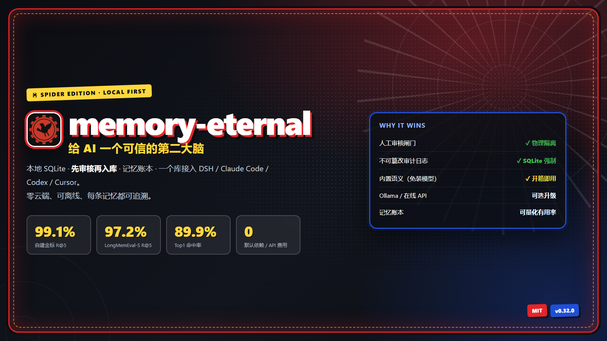</p>

## 📊 实测（2026-11-12）

| 排名 | 方案 | 自建金标 R@5 | LongMemEval-S R@5 | Top1 | 依赖 |
|---|---|---|---|---|---|
| 🥇 | **Ollama（bge-m3）** | **99.1%** | **97.2%**（500 题全量） | **89.9%** | 本机模型 |
| 🥈 | **内置语义（默认）** | 96.3% | 95.4%（500 题全量） | 86.2% | **零依赖** |
| 🥉 | Mem0（对照） | — | 94.4%（QA 分） | — | 云 / 模型 |

> 10 维综合分：**8.54 / 8.48**，位列第一梯队（OMEGA 8.47）；完整排名、部署与成本对比见 **[对比页](bench/comparison.html)**。
> 检索分 ≠ QA 分，两列不混比；改写题 R@5 40% → **70%**，噪声查询 Top1 60% → **95%**。

<p align="center">
  
  
  
  
</p>

[English](README.en.md) · **简体中文（默认）**

## 📸 界面（蜘蛛侠皮肤）

<p align="center">
  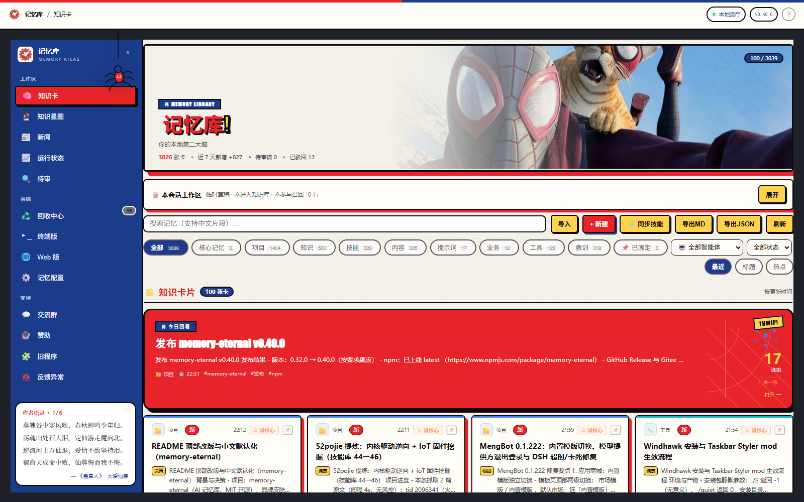
  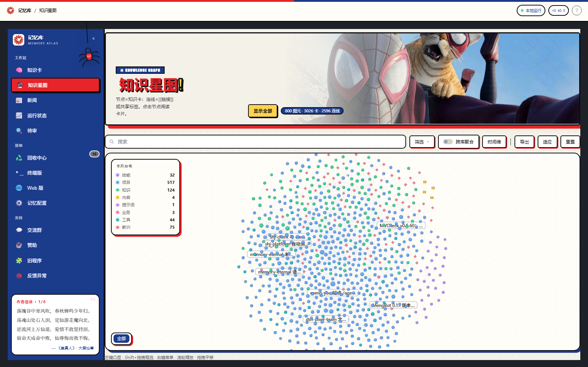
</p>
<p align="center">
  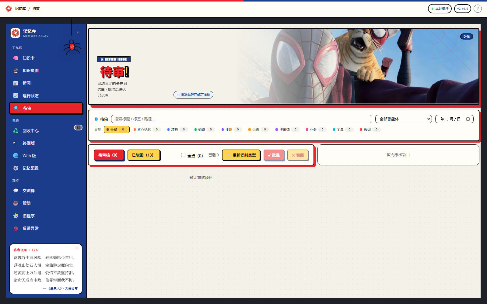
  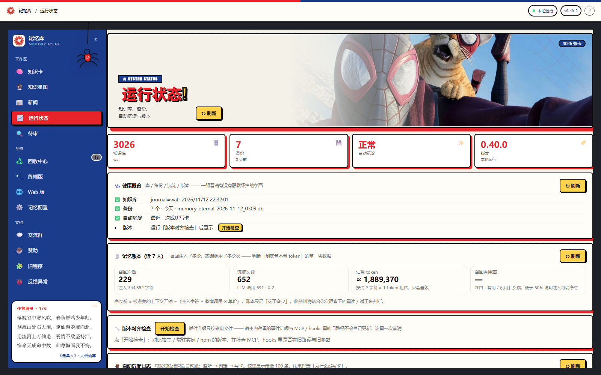
</p>

**记忆核心（memory-eternal）** —— 给 AI 一个不会忘、可审核、可量化的长期记忆。本地优先 · 审核闸门 · 记忆账本 · 一个库接入 DSH / Claude Code / Codex / Cursor 与任意 MCP 客户端。

> **你的 AI 每次会话都失忆。给它一个可信的记忆库。**
>
> 本地优先、先审后入、可度量 —— 一个 SQLite 库，DSH / Claude Code / Codex / Cursor 与任意 MCP 客户端共享。

- 🔍 **先审核，再入库** —— 新卡先进待审队列，Web 或终端里批准/驳回；每次状态变更写入不可篡改的审计日志。
- ✏️ **可编辑、可修订** —— 在阅读器里直接改卡片，或让 agent 提交**修改副本**（`memory_revise`）；审核中心把它标成「✏️ 修改」，人批准后才覆盖原卡。
- 🧾 **记忆账本** —— 召回注入了多少、蒸馏调了几次、召回到底有没有用，全部可查。
- 🏠 **本地优先，零云端** —— SQLite + Markdown 存在你自己的磁盘上。没有第三方记忆框架、不需要账号；记忆数据不外发，只有「动态」资讯会按需请求公开 RSS / Hacker News（只取标题、摘要与外链）。
- ⭐ **核心记忆** —— 已批准的卡可提升为「每次会话强制注入」的核心记忆；自动沉淀可以建议，但最终仍由审核中心决定。
- 🧭 **阅读与布局** —— 卡片目录可点击跳转；记忆界面支持紧凑 / 标准 / 大三种布局大小。

<p align="center"><strong>⭐ 如果它帮你少解释了一遍上下文，点个 Star 就是最大的支持</strong><br/><sub>DSH 一条命令：<code>dsh plugin --profile desktop add memory-eternal</code></sub></p>

## ⚡ 快速开始

**DeepSeek Harness（桌面版 / Web）**

```bash
dsh plugin --profile desktop add memory-eternal
# 重开 DSH → 左栏「记忆」
```

**Claude Code、Codex 或 Cursor —— 通过 MCP 共享同一个库**

```bash
npm i -g memory-eternal
dsh-memory connect claude    # 或：codex / cursor
```

**任意 MCP 客户端**（MengBot / OpenClaw / Hermes 的配置见 [docs/INTEGRATIONS.md](docs/INTEGRATIONS.md)）

```bash
npx -y -p memory-eternal dsh-memory mcp
```

**浏览器或终端**

```bash
dsh-memory open              # http://127.0.0.1:7999
npx -y -p memory-eternal dsh-memory tui   # 终端里的实时待审队列
```

## 🧬 底层记忆是怎么流动的

一个 SQLite 库、一道写入闸门、两条读取路径。**没过闸门的东西，永远不会被召回。**

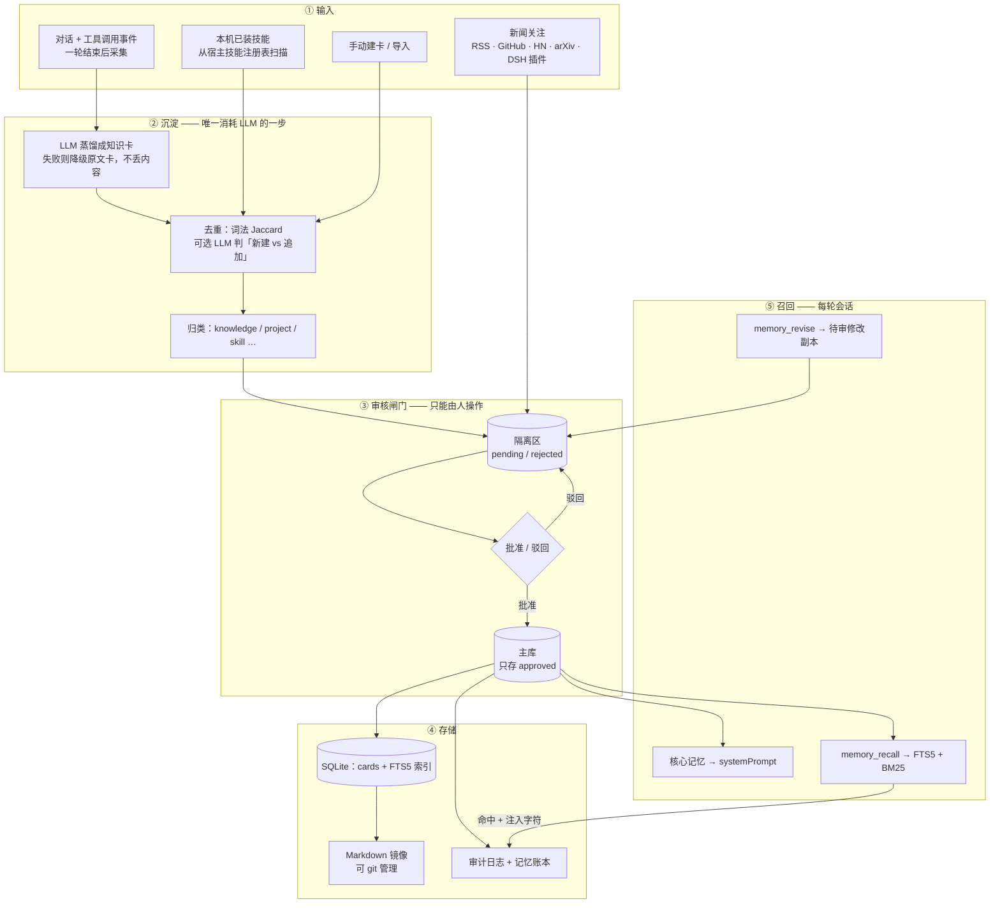

这张图之所以成立，是因为三条不变量**写在代码里**，不是写在文档里：

| 不变量 | 由什么保证 |
|---|---|
| 主库**物理上只存 approved** | 两张物理表；所有读取路径只查主库 |
| Agent **永远不能批准自己的记忆** | Agent 只能写进隔离区；批准/驳回是 UI / TUI / CLI 里的人工动作 |
| 召回**零模型调用** | FTS5 + BM25；LLM 只在沉淀时运行 |

## 🏗 完整底层架构

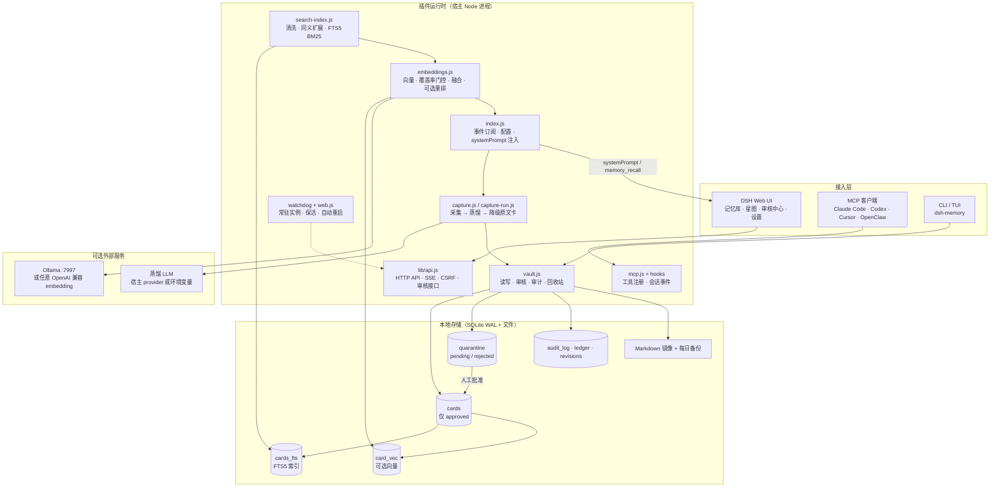

三层职责：**接入层**只负责展示与调用；**运行时**负责采集、检索、审核、注入；**存储层**用 SQLite 物理隔离 approved / pending，Markdown 只是可读镜像。外部只有两处可选依赖：蒸馏 LLM 和 embedding 服务，都可完全关掉。

## 🔌 Agent 与记忆的交互通道

| 通道 | 方向 | 何时 | 闸门 | 成本 |
|---|---|---|---|---|
| `memory_recall` | Agent → 记忆 | 按需 | 只读已批准 | **0 次模型调用**（p50 2.3ms） |
| 核心记忆 | 记忆 → Agent | 每轮会话自动 | 只读已批准 | 约 0.2k 字符 |
| 会话沉淀 / `memory_write` | 对话 → 记忆 | 一轮结束 | **进待审队列** | 1 次 LLM |
| `memory_revise` | Agent → 记忆 | 按需 | **进待审「修改副本」** | 0 |
| 审核（Web / TUI / CLI） | 人 → 记忆 | 手动 | — | 0 |
| Hook（Claude Code / Codex / Cursor） | 宿主 → 记忆 | 会话结束 | **进待审** | 1 次 LLM |
| MCP 服务 | 任意 MCP 客户端 | 按需 | 同上 | 同上 |
| 新闻关注 | 网络 → 记忆 | 按间隔 / 24h | 与知识卡隔离 | 仅网络 |

## 🧾 真的省 token 吗？

大多数记忆产品都说自己省 token。我们认为你应该自己验证。插件内置**记忆账本**（运行状态 → 记忆账本），记录：

| 记录项 | 含义 |
|---|---|
| 召回：命中数 + 注入字符 | 到底有多少记忆进入了上下文 |
| 沉淀：LLM 调用次数 + 输入/输出字符 | 蒸馏花了你多少成本 |
| 有用率：有用 / 没用 反馈 | 召回的记忆是否真的帮上了忙 |

诚实的算式：

```text
净收益 ≈ 被避免的上下文开销 −（注入字符 + 蒸馏调用 × 单价）
```

| 场景 | 你要付 | 你能省 |
|---|---|---|
| 有决策与踩坑记录的多会话项目 | 每次召回约 0.6–0.9k token | 重新解释上下文（约 1.5–3k）或重读文件（3–6k） |
| 一次性问题、低命中率 | 召回注入 | 通常什么也省不到 |

> 以上是示意数字，不是 benchmark —— 用账本测你自己的。如果召回有用率长期低于约 60%，就调小（更少条数、更短摘要）或直接关掉记忆。

## 📊 与同类产品的实测对比

> 只挑 GitHub 上眼熟的项目（按 Stars）；两张表，前三名 🥇🥈🥉。完整可视化版见 [bench/comparison.html](bench/comparison.html)。

**表 1 · 综合排名（10 维加权，判断分）**

| 排名 | 项目 | 召回 | 语义 | 隐私 | 治理 | 成本 | 总分 |
|---|---|---|---|---|---|---|---|
| 🥇 1 | **memory-eternal（Ollama）** | 8.6 | 8.6 | 9.5 | 9.0 | 8.0 | **8.54** |
| 🥈 2 | **memory-eternal（内置语义）** | 7.1 | 6.8 | 9.5 | 9.0 | 9.5 | **8.48** |
| 🥉 3 | Mem0（68.8k★） | 9.3 | 9.0 | 6.0 | 6.0 | 6.5 | 7.49 |
| 4 | MemOS（12.4k★） | 8.5 | 8.5 | 7.0 | 6.0 | 7.0 | 7.38 |
| 5 | graphiti（32.8k★） | 7.8 | 8.5 | 8.0 | 6.0 | 7.0 | 7.26 |
| 6 | basic-memory（4.6k★） | 6.5 | 6.5 | 9.0 | 6.0 | 9.0 | 7.26 |
| 7 | Letta（25.4k★） | 8.0 | 8.5 | 8.0 | 6.0 | 6.5 | 7.22 |
| 8 | mcp-memory-service（2.1k★） | 6.0 | 6.0 | 9.0 | 5.0 | 9.5 | 7.17 |
| 9 | memobase（3.0k★） | 7.2 | 7.0 | 8.0 | 6.0 | 8.0 | 7.15 |
| 10 | cognee（33.3k★） | 8.0 | 8.5 | 8.0 | 5.5 | 7.0 | 7.14 |
| 11 | supermemory（31.6k★） | 8.0 | 8.0 | 6.5 | 5.5 | 6.5 | 7.14 |
| 12 | Zep（5.0k★） | 7.0 | 7.5 | 6.5 | 6.5 | 6.0 | 6.88 |

**表 2 · 公开基准与部署硬指标**

| 排名 | 项目 | LongMemEval QA | 检索 R@5 | 本地 / 零 API | 审核治理 | Stars |
|---|---|---|---|---|---|---|
| 🥇 1 | memory-eternal（Ollama） | 未测 | **97.2%**（500 题） | 需 Ollama | ✅ | 176 |
| 🥈 2 | memory-eternal（内置） | 未测 | **95.4%**（500 题） | ✅ / ✅ | ✅ | 176 |
| 🥉 3 | Mem0 | 94.4% | — | 部分 | 弱 | 68,849 |
| 4 | MemOS | — | — | 部分 | 中 | 12,366 |
| 5 | graphiti | — | — | 部分 | 中 | 32,771 |
| 6 | basic-memory | — | — | ✅ / ✅ | 弱 | 4,557 |
| 7 | Letta | — | — | 部分 | 中 | 25,421 |
| 8 | mcp-memory-service | — | 80.4–86.0% | ✅ / ✅ | 弱 | 2,116 |
| 9 | memobase | — | — | 部分 | 中 | 2,956 |
| 10 | cognee | — | — | 部分 | 中 | 33,263 |
| 11 | supermemory | 81.6–85.2% | — | 部分 | 弱 | 31,595 |
| 12 | Zep | 71.2% | — | ❌ | 中 | 5,005 |

**我们不是这里最大的。** Mem0 有 68.8k 星、成熟团队和托管服务；我们做的不一样的是**写入路径**：人审闸门、三库分离、可指认的审计链，外加一本能自己核对"召回值不值"的账本。表 2 的 97.2% / 95.4% 是 **检索 R@5**，不是 QA；OMEGA 95.4%、Hindsight 91.4% 是自报 QA，仅作参考、不参与排名。

在我们的库上自己复跑：

```bash
node scripts/bench-search.mjs --rebuild   # 重建耗时 + p50/p95/max 延迟
dsh-memory ledger --days 30 --json        # 召回注入 / 沉淀调用 / 有用率
```

| 我们实测的基线（2026-11-12） | 数值 |
|---|---|
| 库内卡片数 | 2,943 |
| 金标 109 题 R@5（内置 / bge-m3） | 96.3% / **99.1%** |
| 金标 109 题 Top1（内置 / bge-m3） | 86.2% / **89.9%** |
| 改写题 10 条 R@5（内置 / bge-m3） | 40% / **70%** |
| LongMemEval-S 500 题 R@5（内置 / bge-m3） | 95.4% / **97.2%** |
| 召回延迟（词法 / 语义） | 约 7 ms / 81 ms |
| 召回模型调用（内置语义） | 0 |

## 🛡️ 先审核，再入库

一个「什么都自动吞进去」的记忆系统，迟早会把错误事实当成真相召回。memory-eternal 默认**先审后入**：

- 新卡先进入**待审队列**，人工批准后才进主库；
- 在 Web、终端 TUI 或 CLI 里批准 / 驳回 / 批量处理；
- 每次状态变更追加到**不可篡改的审计日志**（谁 / 什么 / 何时 / 为什么）—— 由 SQLite 层强制，而不是靠约定；
- Agent 可以读取和提议，但**不能批准自己写的卡**；
- Agent 也可以提交**修改**：已批准卡的副本进待审队列并标注「✏️ 修改原卡：…」；批准 = 用副本覆盖原卡（id / path / 状态不变，更新记录留痕），驳回 = 原卡一字不动；
- 删除的卡进回收站（默认保留 30 天）。

## ⭐ 核心记忆

不是所有内容都该每次注入上下文。核心记忆是一组**必须每次遵守**的偏好与硬约束：

- 任意已批准卡片都可以在阅读器或卡片列表里提升为核心记忆；
- 自动沉淀只会在用户明确要求长期偏好 / 硬约束时**建议**核心，且 core 候选**一律待审**；
- 已批准的核心卡每次会话直接注入 systemPrompt，不依赖 `memory_recall` 调用；
- 在「设置 → 记忆 → 核心记忆」里可配置条数上限和字符预算；
- 知识星图里核心节点显示为橙色菱形 + ★；
- **不要把密钥/Token 的值写进核心卡**，只保存凭证目录的引用。

## 🎛 阅读与布局

- 卡片阅读器右侧目录可点击，平滑跳转到对应章节；
- 「设置 → 记忆 → 布局大小」支持 **紧凑 / 标准 / 大**，只影响界面显示。

## 🧩 一个库，所有 Agent

| 入口 | 你能得到什么 |
|---|---|
| **DSH 桌面版 / Web** | 内嵌记忆界面：审核、图谱、配置、账本 |
| **Claude Code / Codex / Cursor** | MCP server，同一个本地库，<code>dsh-memory connect</code> |
| **任意 MCP 客户端** | <code>npx -y -p memory-eternal dsh-memory mcp</code> |
| **终端** | <code>dsh-memory tui</code> —— 实时队列、全选、批量批/驳、长文读卡 |
| **浏览器** | <code>dsh-memory open</code> → http://127.0.0.1:7999 |

## 🎨 皮肤 / Skins

五套皮肤，设置 → 通用 → 主题皮肤一键切换；选择会本地保存，刷新后保持。

<p align="center">
  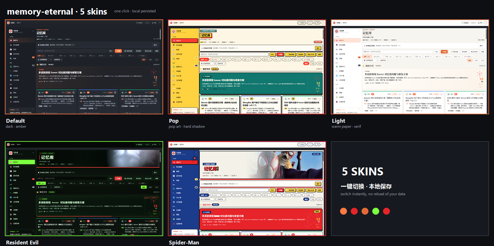
</p>

| 皮肤 | 风格 |
| --- | --- |
| **默认暗色** | 深色底 + 琥珀强调，长时间阅读不刺眼 |
| **波普 Pop** | 黄底黑框、硬阴影、半调与粗黑标题 |
| **明亮 Light** | 暖纸面 + 衬线标题，适合白天 |
| **生化危机** | Umbrella 实验室、毒绿扫描线、B.O.W. 头图与巨爪 |
| **蜘蛛侠** | 红蓝漫画、蛛网、半调、横版动作头图与悬吊挂件 |

## 📸 截图

<p align="center">
  <a href="https://eternalnight996.github.io/memory-eternal/demo/">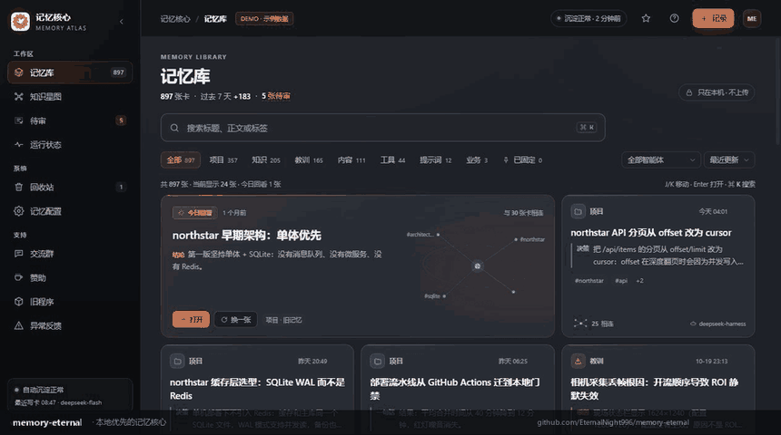</a>
</p>
<p align="center"><sub>▲ 20 秒演示 —— 审核队列 · 记忆账本 · 知识星图 · <a href="https://eternalnight996.github.io/memory-eternal/demo/">在线 Demo</a></sub></p>


<p align="center">
  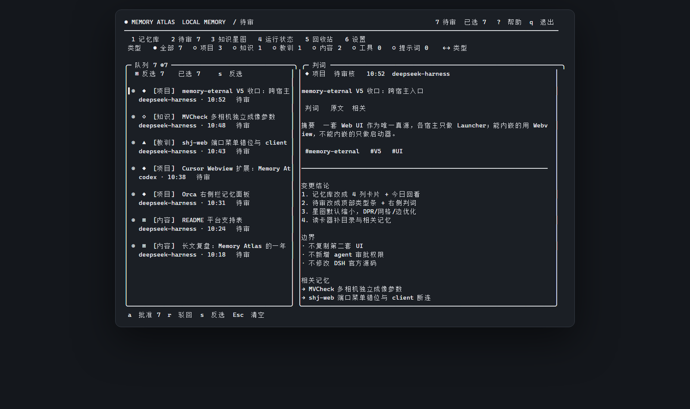
  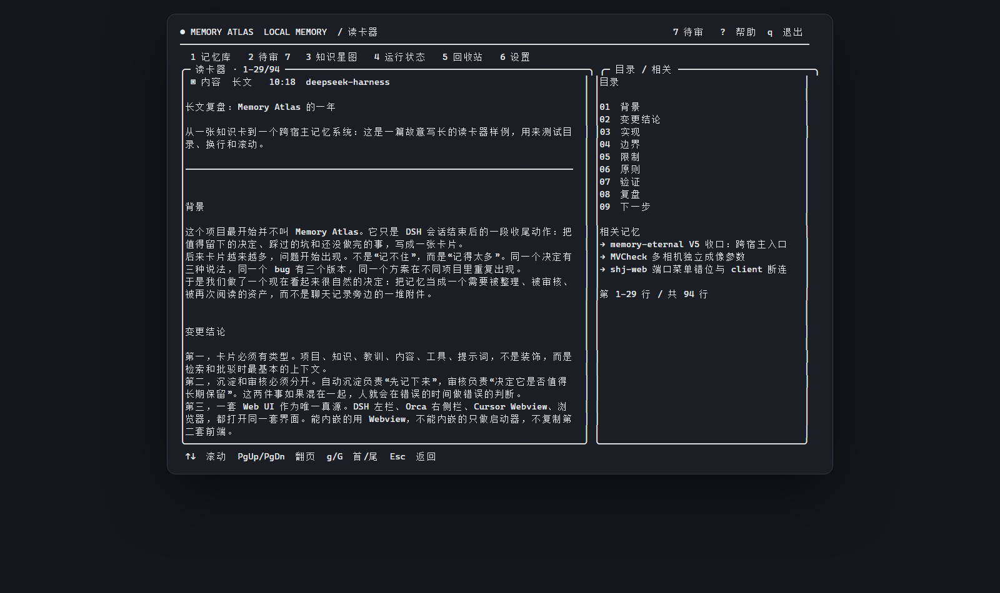
</p>
<p align="center"><sub>▲ 终端原生审核与长文读卡 —— <code>dsh-memory tui</code></sub></p>

## 🔍 语义召回（默认内置，无需装模型）

**新装默认就是内置语义**：零安装、零网络、零费用，同义扩展兜底，开箱即用。三种部署方式：

| 方式 | 说明 |
|---|---|
| 内置语义（默认） | 零依赖；自建集 R@5 96.3%，改写题 40% |
| 本地 Ollama（推荐升级） | bge-m3 向量；R@5 99.1%，改写题 70%，延迟约 100ms |
| 在线 API | OpenAI 兼容端点，按量计费 |

首次打开记忆库会走三步引导，并默认全开：记忆核心 / 自动沉淀 / 自动召回 / 核心记忆注入 / 工作记忆 / 内置语义。设置页「语义召回」右上角可「🧭 引导」重新查看。

升级 Ollama：安装后设 `OLLAMA_HOST=127.0.0.1:7997` 启动 `ollama serve`，面板里「一键拉取模型 → 立即部署」即可。

**实测（2026-11-12）**：自建 109 题内置 R@5 96.3%、Top1 86.2%；+bge-m3 R@5 **99.1%**、Top1 89.9%。
LongMemEval-S 500 题全量：词法 95.2%、语义 **97.2%** R@5（检索口径，非 QA）。

细节见 [docs/EMBEDDINGS.md](docs/EMBEDDINGS.md) 与 [bench/FINAL-REPORT.md](bench/FINAL-REPORT.md)。

## 📚 文档与链接

- [英文完整手册](docs/GUIDE.md) · [完整手册（中文）](docs/GUIDE.zh-CN.md)
- [私有化部署（Docker / systemd）](docs/DEPLOY.md)
- [更新日志](docs/CHANGELOG.md) · [架构](docs/ARCHITECTURE.md)
- [终端插件（dsh-tui）](dsh-tui-plugin/README.md) · [Orca 启动器](orca-plugin/README.md) · [Cursor / VS Code 扩展](cursor-extension/README.md)
- [反馈问题](https://github.com/EternalNight996/memory-eternal/issues)

## 💬 交流群

**遇到问题、想提需求、或者想聊聊 DSH 插件开发 —— 欢迎进群：**

| QQ 交流群 | 微信交流群 |
|:---:|:---:|
| 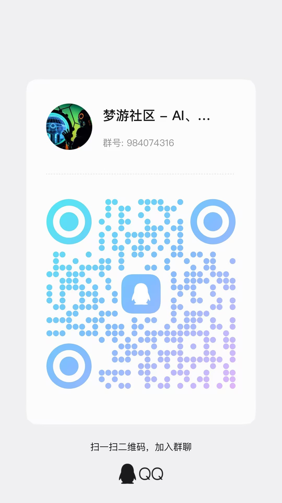 |  |

**如果这个插件帮你省了时间，可以请作者喝杯咖啡（微信 / 支付宝任选其一）：**

| 微信收款码 | 微信赞赏码 | 支付宝 |
|:---:|:---:|:---:|
|  |  |  |

> 打赏完全自愿，不影响任何功能；插件本体始终开源免费（MIT）。详见 [SPONSOR.md](SPONSOR.md)。

## 📄 License

MIT —— 随便用、随便自托管、随便二次开发。

## 🖋 作者语录

_「大爱」二字，是全篇最大的反讽。面板左栏底部同步轮播。_

> 落魄谷中寒风吹，春秋蝉鸣少年归。<br>
> 荡魂山处石人泪，定仙游走魔向北。<br>
> 逆流河上万仙退，爱情不敌坚持泪。<br>
> 宿命天成命中败，仙尊悔而我不悔。

> 早岁已知世事艰，仍许飞鸿荡云间。

> 男儿不展凌云志，空负天生八尺躯。

> 千古地仙随风逝，昔日三王归青冢。<br>
> 阳莽悍陨谁无败？卷土重来再称王。

> 天河一挂淘龙鱼，逆天独行顾八荒。<br>
> 今朝暂且展翼去，明朝飞仙笞凤凰！

> 独帜入渊深未知，身似浮萍命难持。<br>
> 千舟皆朝归海处，一苇青拨戏浪巅。<br>
> 惊鸿四散鱼逃尽，唯有残帆傲此间。<br>
> 待到天开云雾散，负手直望笑苍天。

<p align="right"><sub>——《蛊真人》· 大爱仙尊</sub></p>

---

## 🌟 贡献者

感谢每一位让记忆核心更好用的人。

| 贡献者 | 贡献 |
| --- | --- |
| [@aloneangel45](https://github.com/aloneangel45) | 发现并修复 [#54](https://github.com/EternalNight996/memory-eternal/issues/54) —— `tools` 服务晚挂载时 `memory_recall` / `memory_note` 从未注册（[#58](https://github.com/EternalNight996/memory-eternal/pull/58)） |
| [@EternalNight996](https://github.com/EternalNight996) | 作者与维护者 |

有想落地的修复？欢迎开 issue 或 PR —— 每个被合并的贡献都会出现在这里。

