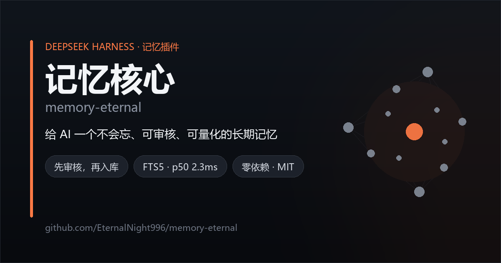
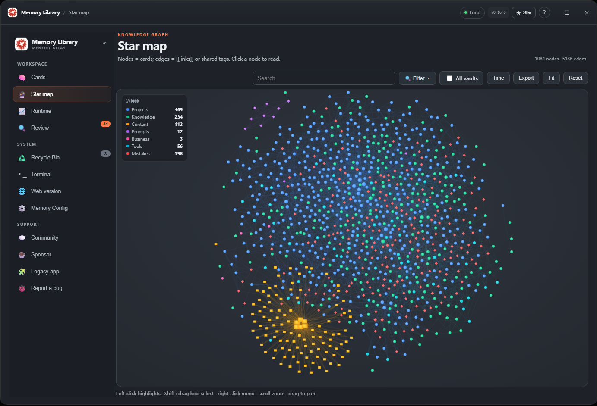
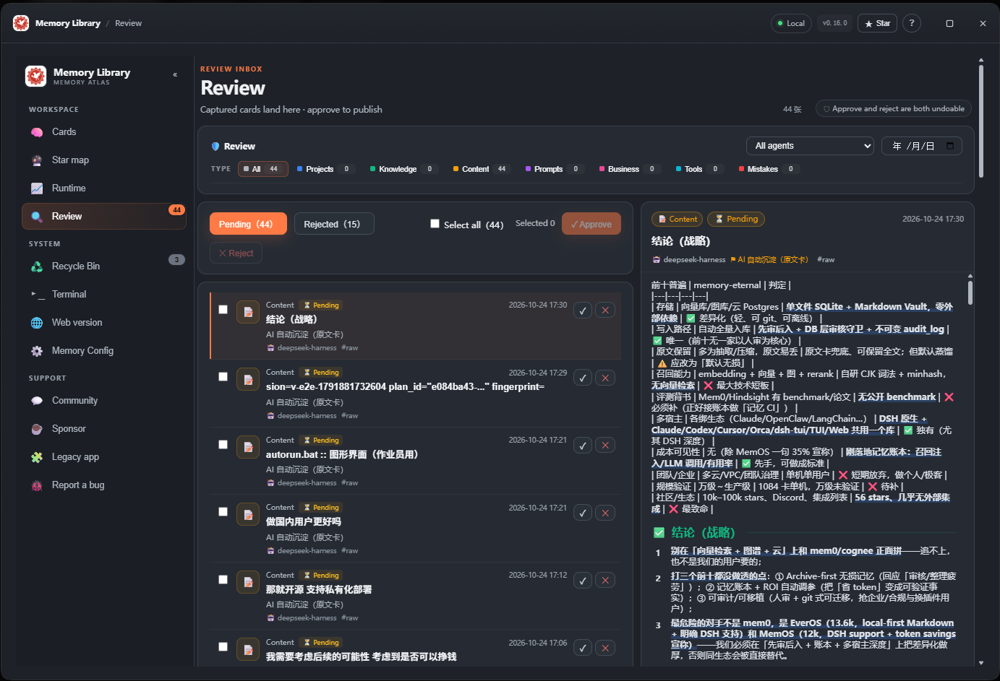
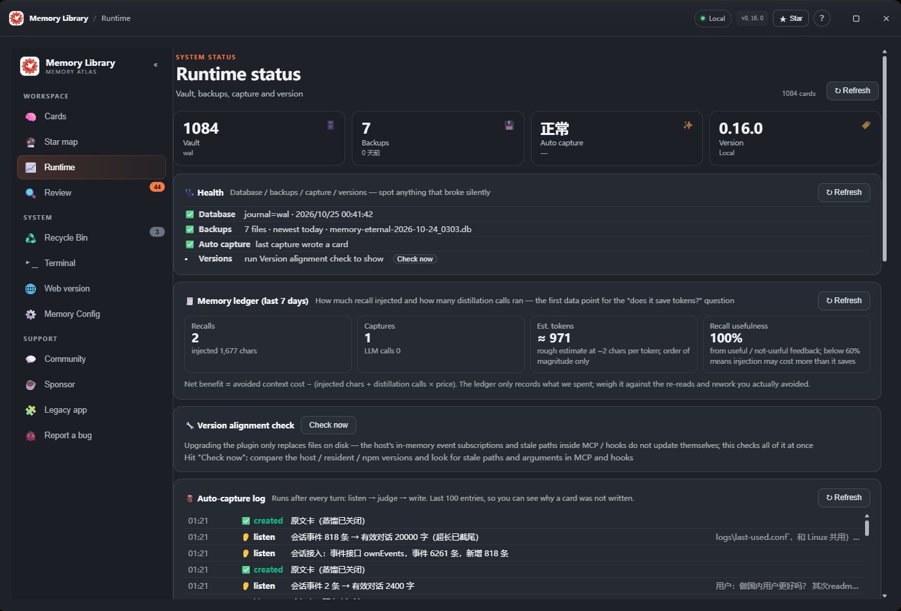
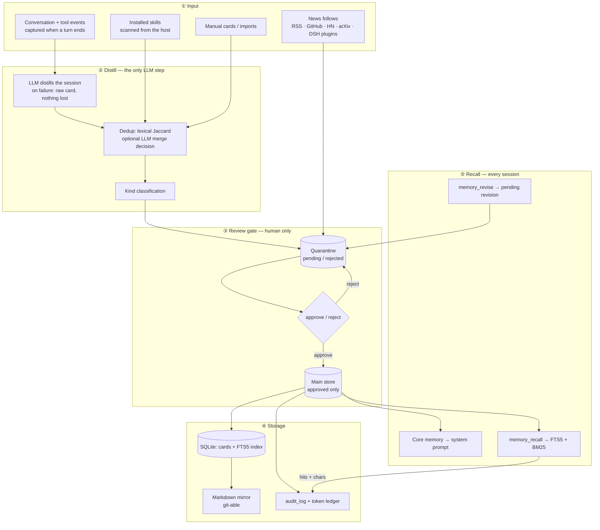

# 🧠 memory-eternal — a second brain for your AI

<p align="center">
  
</p>

<p align="center">
  
  
  
</p>
<p align="center"><sub>▲ Knowledge graph · review inbox · runtime status</sub></p>

**记忆核心（memory-eternal）** —— 给 AI 一个不会忘、可审核、可量化的长期记忆。本地优先 · 审核闸门 · 记忆账本 · 一个库接入 DSH / Claude Code / Codex / Cursor 与任意 MCP 客户端。

[](https://github.com/EternalNight996/memory-eternal/stargazers)
[](https://www.npmjs.com/package/memory-eternal)
[](https://github.com/EternalNight996/memory-eternal/releases)
[](LICENSE)

**English (default)** · [简体中文](README.zh-CN.md)

> **Your AI forgets every session. Give it a memory it can trust.**
>
> Local-first, review-gated, measurable — one SQLite vault shared by DSH, Claude Code, Codex, Cursor and any MCP client.

- 🔍 **Review before it counts** — new cards wait in a review queue; approve or reject from the Web UI or terminal; every change is written to an immutable audit log.
- ✏️ **Editable & revisable** — fix a card by hand in the reader, or let an agent submit a **revised copy** (`memory_revise`); the queue labels it a revision, and an approved card is only overwritten when you approve it.
- 🧾 **Token ledger** — see how much recall injected, how many distillation calls ran, and how often recall was actually useful.
- 🏠 **Local-first, no cloud** — SQLite + Markdown on your own disk. No third-party memory framework, no account. Memory data never leaves the machine; only the News page fetches public RSS / Hacker News on demand (titles, excerpts and outbound links only).
- ⭐ **Core memory** — promote approved cards to always-on memory; every session gets them automatically, and the review queue still decides what qualifies.
- 🧭 **Reader & layout** — clickable table of contents in the card reader, plus a compact / normal / large layout setting for the whole memory UI.

<p align="center"><strong>⭐ If it saves you from explaining the same context again, a star helps a lot.</strong><br/><sub>DSH one-liner: <code>dsh plugin --profile desktop add memory-eternal</code></sub></p>

## ⚡ Quick start

**DeepSeek Harness (desktop / web)**

```bash
dsh plugin --profile desktop add memory-eternal
# reopen DSH → sidebar "Memory"
```

**Claude Code, Codex or Cursor — same vault via MCP**

```bash
npm i -g memory-eternal
dsh-memory connect claude    # or: codex / cursor
```

**Any MCP client**

```bash
npx -y -p memory-eternal dsh-memory mcp
```

**Browser or terminal**

```bash
dsh-memory open              # http://127.0.0.1:7999
npx -y -p memory-eternal dsh-memory tui   # live queue in the terminal
```

## 🧬 How memory actually flows

One SQLite vault, one write gate, two read paths. Nothing enters recall without passing the gate.



The diagram is only true because three invariants are enforced in code, not by convention:

| Invariant | Enforced by |
|---|---|
| The main store **only** ever contains approved cards | Two physical tables; every read path queries the main one |
| An agent can never approve its own memory | Agent writes land in quarantine; approve/reject is a human action in the UI / TUI / CLI |
| Recall costs **zero model calls** | FTS5 + BM25; the LLM runs only while distilling |

## 🔌 How agents talk to the memory

| Channel | Direction | When | Gate | Cost |
|---|---|---|---|---|
| `memory_recall` | agent → memory | on demand | approved only | **0 model calls** (p50 2.3 ms) |
| Core memory | memory → agent | every session, automatic | approved only | ~0.2k chars |
| Session capture / `memory_write` | conversation → memory | turn end | **queued for review** | 1 LLM call |
| `memory_revise` | agent → memory | on demand | **queued as a revision** | 0 |
| Review (Web UI · TUI · CLI) | human → memory | manual | — | 0 |
| Hooks (Claude Code / Codex / Cursor) | host → memory | session end | **queued** | 1 LLM call |
| MCP server | any MCP client | on demand | same gate | same |
| News follows | web → memory | interval / 24h | isolated from cards | network only |

## 🧾 Does it actually save tokens?

Most memory products <em>say</em> they save tokens. We think you should check. The plugin ships a built-in **memory ledger** (Runtime status → Memory ledger) that records:

| Recorded | What it means |
|---|---|
| recall: hits + injected characters | how much memory actually entered the context |
| capture: LLM calls + input/output characters | what distillation cost you |
| usefulness: useful / not-useful feedback | whether recalled memories actually helped |

The honest math:

```text
net benefit ≈ avoided context cost − (injected characters + distillation calls × price)
```

| Scenario | You pay | You avoid |
|---|---|---|
| Multi-session project with decisions and pitfalls | ~0.6–0.9k tokens per recall | re-explaining context (~1.5–3k) or re-reading files (3–6k) |
| One-off question, low hit rate | recall injection | usually nothing |

> Illustrative numbers, not a benchmark — measure your own with the ledger. If recall usefulness stays below ~60%, tune it down (fewer results, shorter summaries) or turn memory off.

## 📊 How it compares — measured on a real vault

Snapshot **2026-11-07**. Our figures are measured on a real **2,321-card vault** on Windows (not a toy corpus); competitor facts come from their public README / docs / license page on the same date. `—` means *not advertised or not verifiable*, not "absent".

| Capability | **memory-eternal v0.25.0** | [agentmemory](https://github.com/rohitg00/agentmemory) v0.9.32 | [mem0](https://github.com/mem0ai/mem0) v3 | [Obsidian](https://obsidian.md) | CLAUDE.md / AGENTS.md |
|---|---|---|---|---|---|
| Form factor | DSH-native plugin: capture, review UI, graph, CLI/TUI/MCP | local memory server + MCP for coding agents | memory SDK / self-hosted server / cloud | local Markdown notes app | hand-written context files |
| Storage | SQLite + Markdown mirror (git-friendly) | local file store (Redis optional) | vector + graph stores (self-hosted or cloud) | Markdown files on disk | one flat file |
| Write gate | **human review queue** (three stores) | automatic capture, no review | LLM extraction, no review | human-written only | none |
| Immutable audit log | ✅ enforced at the SQLite layer | operation audit tool, not storage-enforced | — | — | — |
| Retrieval | FTS5 + **BM25/IDF**, column weights | BM25 + vector + graph (local embeddings optional) | semantic + BM25 + entity + graph | full-text search / plugins | whole file injected |
| Recall latency | **p50 2.33 ms · p95 6.18 ms** | — | p50 ~0.88–1.09 s (vendor paper, cloud) | grows with vault size | grows with file size |
| Recall model calls | **0** (BM25 only) | 0 for keyword; 1 embedding call when semantic is on | 1 embedding call + optional LLM rerank | 0 | 0 |
| Model calls per write | 1 when auto-capture runs (can be off) | 0 by default (synthetic compression); LLM optional | ≥1 LLM call per add | 0 | 0 |
| Token ledger (measured usefulness) | ✅ | — | platform usage dashboard | — | — |
| Multi-agent | DSH + MCP + hooks + TUI + browser | MCP + REST: Claude Code, Codex, Cursor, DSH, … | Python/TS SDK, self-hosted server, cloud | no native agent interface | loaded per tool |
| License | MIT | Apache-2.0 | Apache-2.0 | proprietary (free for all use) | n/a |

**We are not the biggest here.** mem0 has a funded team, a research paper and a managed service; agentmemory's automatic capture covers more coding agents than we do; Obsidian is where many people already keep their notes. What we do differently is the *write path*: a human gate, a three-store separation, and an audit trail you can point at — plus a token ledger so you can check whether recall is worth its cost.

Reproduce our numbers on your own vault:

```bash
node scripts/bench-search.mjs --rebuild   # rebuild time + p50/p95/max latency
dsh-memory ledger --days 30 --json        # recall injection / capture / usefulness
```

| Our measured baseline | Value |
|---|---|
| Cards indexed | 2,321 |
| Index rebuild (cold) | 869 ms |
| Recall p50 / p95 / max | 2.33 / 6.18 / 7.60 ms |
| Recall throughput | ~431 queries/s |
| Recall model calls | 0 |
| Injection per recall (60-day ledger) | ~1,394 chars |

## 🛡️ Review first, prove later

A memory system that silently ingests everything will eventually recall a wrong fact as truth. memory-eternal defaults to **review-before-commit**:

- new cards land in a **pending queue**; nothing enters the main vault until a human approves it;
- approve, reject or bulk-process from the Web UI, the terminal TUI, or the CLI;
- every status change is appended to an **immutable audit log** (who / what / when / why) — enforced at the SQLite layer, not by convention;
- agents can read and propose, but **cannot approve their own cards**;
- agents can also submit a **revision**: a copy of an approved card lands in the queue marked “✏️ revision of …”; approving it overwrites the original (id, path and status preserved, an entry appended to the card's update log), rejecting it leaves the original untouched;
- deleted cards go to a recycle bin (30 days by default).

## ⭐ Core memory

Not everything should be injected into every session. Core memory is the small, explicit set of rules and preferences that must always win:

- any approved card can be promoted from the reader or card list;
- auto-capture may **suggest** core only for explicit long-term preferences / hard constraints, and core candidates always stay pending for review;
- approved core cards are injected into the system prompt of every session — no `memory_recall` call needed;
- set a card limit and character budget in Settings → Memory → Core memory;
- in the knowledge graph, core nodes are orange diamonds with a ★;
- never store secrets or API keys in a core card; keep only a pointer to the credential directory.

## 🎛 Reader & layout

- click any heading in the reader's table of contents to smoothly scroll to that section;
- Settings → Memory → Layout size offers **compact / normal / large** for the whole UI; it only affects display.

## 🧩 One vault, every agent

| Entry | What you get |
|---|---|
| **DSH desktop / web** | embedded memory UI: review, graph, config, ledger |
| **Claude Code / Codex / Cursor** | MCP server, same local vault, <code>dsh-memory connect</code> |
| **Any MCP client** | <code>npx -y -p memory-eternal dsh-memory mcp</code> |
| **Terminal** | <code>dsh-memory tui</code> — live queue, select-all, batch approve/reject, long-form reader |
| **Browser** | <code>dsh-memory open</code> → http://127.0.0.1:7999 |

## 📸 Screenshots

<p align="center">
  <a href="https://eternalnight996.github.io/memory-eternal/demo/"></a>
</p>
<p align="center"><sub>▲ 20-second tour — review queue · token ledger · knowledge graph · <a href="https://eternalnight996.github.io/memory-eternal/demo/">live demo</a></sub></p>


<p align="center">
  
  
</p>
<p align="center"><sub>▲ Terminal-native review and long-form reading — <code>dsh-memory tui</code></sub></p>

## 📚 Documentation & links

- [Full manual (English)](docs/GUIDE.md) · [完整手册（中文）](docs/GUIDE.zh-CN.md)
- [Private deployment (Docker / systemd)](docs/DEPLOY.md)
- [Changelog](docs/CHANGELOG.md) · [Architecture](docs/ARCHITECTURE.md)
- [Terminal plugin (dsh-tui)](dsh-tui-plugin/README.md) · [Orca launcher](orca-plugin/README.md) · [Cursor / VS Code extension](cursor-extension/README.md)
- [Report a bug](https://github.com/EternalNight996/memory-eternal/issues)

## 💬 Community

**Questions, ideas, or DSH plugin talk — join the groups:**

| QQ group | WeChat group |
|:---:|:---:|
|  |  |

**Buy the author a coffee (optional):**

| WeChat Pay | WeChat Reward |
|:---:|:---:|
|  |  |

> Sponsorship is optional; the plugin stays MIT and free. See [SPONSOR.md](SPONSOR.md).

## 📄 License

MIT — use it, self-host it, build on it.

## 🖋 Author's Quotes

_Verses from 《蛊真人》(Reverend Insanity). Kept in the original Chinese — a translation would lose the meter. Also rotating at the bottom of the panel's left rail._

> 落魄谷中寒风吹，春秋蝉鸣少年归。<br>
> 荡魂山处石人泪，定仙游走魔向北。<br>
> 逆流河上万仙退，爱情不敌坚持泪。<br>
> 宿命天成命中败，仙尊悔而我不悔。

> 早岁已知世事艰，仍许飞鸿荡云间。

> 男儿不展凌云志，空负天生八尺躯。

> 千古地仙随风逝，昔日三王归青冢。<br>
> 阳莽悍陨谁无败？卷土重来再称王。

> 天河一挂淘龙鱼，逆天独行顾八荒。<br>
> 今朝暂且展翼去，明朝飞仙笞凤凰！

> 独帜入渊深未知，身似浮萍命难持。<br>
> 千舟皆朝归海处，一苇青拨戏浪巅。<br>
> 惊鸿四散鱼逃尽，唯有残帆傲此间。<br>
> 待到天开云雾散，负手直望笑苍天。

<p align="right"><sub>——《蛊真人》· 大爱仙尊</sub></p>

