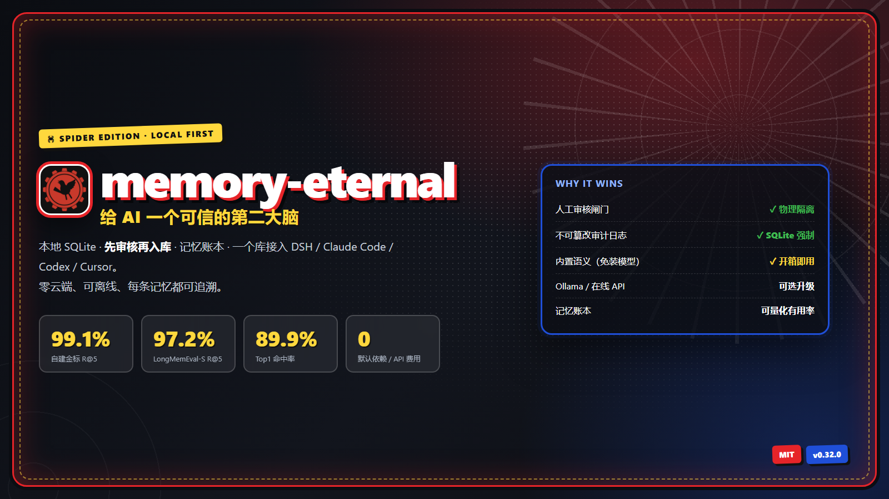
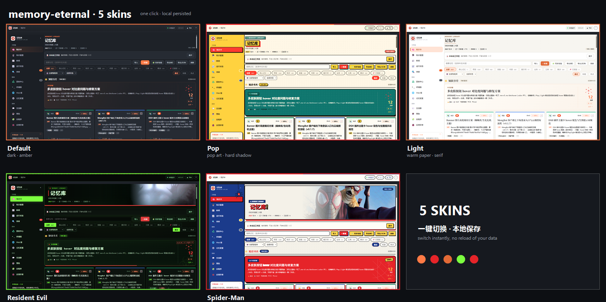
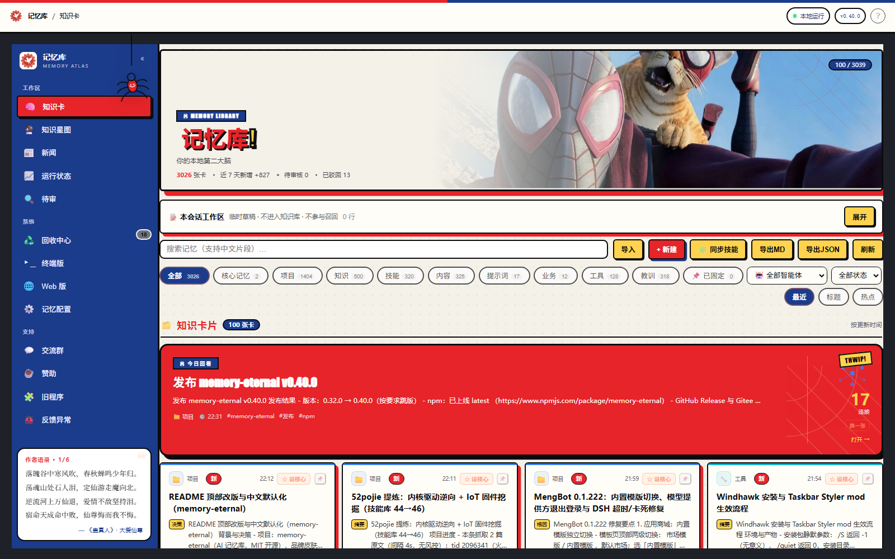
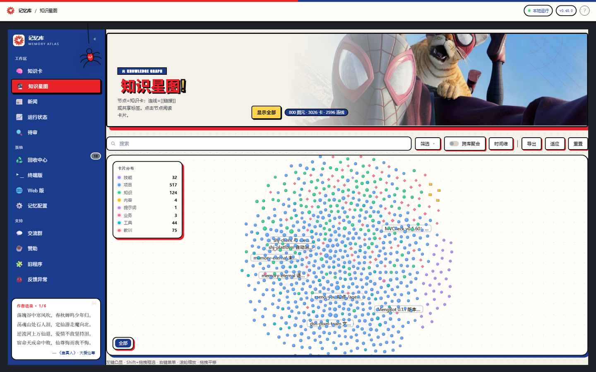
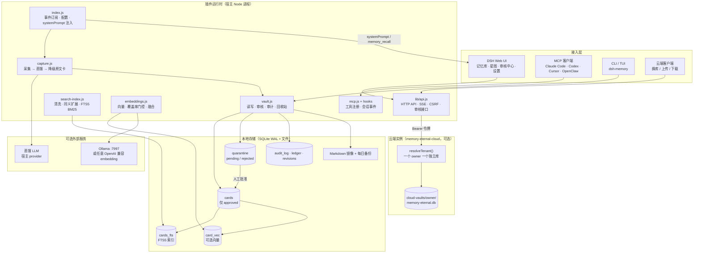
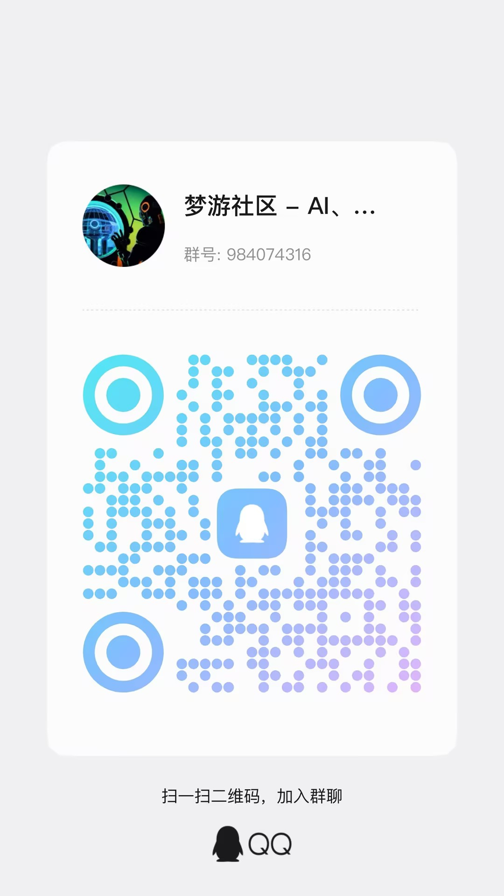

# 🧠 memory-eternal —— 给 AI 装一个可信的第二大脑

<p align="center"></p>

<p align="center"></p>

<p align="center">
  
  
  
  
</p>

[English](README.en.md) · **简体中文（默认）**

## ☁️ 云端记忆（v0.49.10 主打）

**记忆库跟着人走，不跟着机器走。** 本机库照旧离线可用；登录云端后，同一套知识卡在你的每台设备、每个
Agent 上都能读到 —— 换电脑不用搬家，换客户端不用重新喂上下文。

| 能力 | 你能得到 |
|---|---|
| **一次登录** | MengBot 账号扫码 / 邮箱登录，或在任意实例上签发的访问密钥（`me_…`） |
| **一人一库** | 云端按 owner 分目录，**每个用户一个独立 SQLite**（`cloud-vaults/{owner}/memory-eternal.db`），物理隔离 |
| **换库不重启** | 本地库 ↔ 云端库**热切换**（`POST /vaults/switch`）：知识卡、星图、待审、回收站一次性换源，不刷新页面 |
| **上传 / 下载** | 整库复制（本机 → 云端、云端 → 本机），分片传输 + **断点续传** + 中途取消 + 失败重试 3 次，重复内容自动跳过 |
| **离线优先** | 云端不可达自动熔断、回退本地库，首屏最多等 3 秒；本地记忆一分不丢 |
| **自有实例** | 自己的服务器跑 `memory-eternal-cloud`（systemd / Docker + HTTPS 反代），密钥可签发、可吊销、只存 sha256 |
| **发密钥三处入口** | **CLI**（`dsh-memory cloud keys issue`，本地台账模式免令牌）· **面板**「🔑 服务端密钥管理」· curl；管理令牌首次启动自动生成 |

```bash
# ① 起一个云端实例（默认关闭，不开就是纯本地）
MEMORY_CLOUD=1 node lib/web.js --port 7999     # Docker / systemd 部署见 docs/CLOUD.md
# 首次启动会自动生成管理令牌 → $DSH_HOME/cloud-admin-token（0600，日志打印一次）

# ② 签发访问密钥（三选一）
dsh-memory cloud keys issue --owner alice --note 笔记本   # CLI：能在这台机跑命令就是管理员，免令牌、立即生效
# 或：面板 → 设置 → 🧪 实验性 → 云端连接 → 「🔑 服务端密钥管理」→ 粘贴管理令牌 → 新建
curl -X POST http://127.0.0.1:7999/memory-eternal/api/cloud/keys \
  -H "Authorization: Bearer $MEMORY_CLOUD_ADMIN_TOKEN" \
  -H 'Content-Type: application/json' -d '{"owner":"alice"}'

# ③ 面板：设置 → 🧪 实验性 → 云端连接 → 填地址 + 密钥 → [测试连接] → [保存并切换]
```

> 反代 / 容器部署记两个变量：`MEMORY_CLOUD_ADMIN_TOKEN`（不配就用自动生成的那把；配了以它为准）、`MEMORY_PUBLIC_HOST`（写请求的 Host 白名单，填你的域名）。
> 边界说明：云端服务端（多租户 + 鉴权 + 计费对接）是**独立私有组件**，不随本开源包发布；
> 相关接口仍在快速迭代、可能微调。不用云端时，本地功能与之前完全一致 —— 见 [docs/CLOUD.md](docs/CLOUD.md)、[docs/PRIVATE.md](docs/PRIVATE.md)。

## 📊 与同类产品的实测对比

> 数据日期 **2026-11-15**：Stars 取自 GitHub API（整数实值）；公开成绩按各自 README / 论文**原文口径**转录，
> 不同指标的分数绝不混排。可视化版见 [bench/comparison.html](bench/comparison.html)，口径与复跑脚本见 [bench/COMPARISON.md](bench/COMPARISON.md)。

**表 1 · 记忆类：综合判断（10 维加权，我们自己的评分口径）**

| 排名 | 项目 | 召回 | 语义 | 隐私 | 治理 | 成本 | 总分 |
|---|---|---|---|---|---|---|---|
| 🥇 1 | **memory-eternal（Ollama）** | 8.6 | 8.6 | 9.5 | 9.0 | 8.0 | **8.54** |
| 🥈 2 | **memory-eternal（内置语义）** | 7.1 | 6.8 | 9.5 | 9.0 | 9.5 | **8.48** |
| 🥉 3 | Mem0（69.0k★） | 9.3 | 9.0 | 6.0 | 6.0 | 6.5 | 7.49 |
| 4 | MemOS（12.4k★） | 8.5 | 8.5 | 7.0 | 6.0 | 7.0 | 7.38 |
| 5 | graphiti（32.8k★） | 7.8 | 8.5 | 8.0 | 6.0 | 7.0 | 7.26 |
| 6 | basic-memory（4.6k★） | 6.5 | 6.5 | 9.0 | 6.0 | 9.0 | 7.26 |
| 7 | Letta（25.4k★） | 8.0 | 8.5 | 8.0 | 6.0 | 6.5 | 7.22 |
| 8 | mcp-memory-service（2.1k★） | 6.0 | 6.0 | 9.0 | 5.0 | 9.5 | 7.17 |
| 9 | memobase（3.0k★） | 7.2 | 7.0 | 8.0 | 6.0 | 8.0 | 7.15 |
| 10 | cognee（33.3k★） | 8.0 | 8.5 | 8.0 | 5.5 | 7.0 | 7.14 |
| 11 | supermemory（31.6k★） | 8.0 | 8.0 | 6.5 | 5.5 | 6.5 | 7.14 |
| 12 | Zep（5.0k★，产品闭源） | 7.0 | 7.5 | 6.5 | 6.5 | 6.0 | 6.88 |

**表 2 · 记忆类：公开基准与部署硬指标**

| 项目 | Stars | 公开成绩（原文口径） | 本地 / 零 API | 人工审核闸门 |
|---|---|---|---|---|
| **memory-eternal（bge-m3）** | 176 | 自建 500 题 **R@5 97.2%**（检索口径） | 需 Ollama | ✅ |
| **memory-eternal（内置）** | 176 | 自建 500 题 **R@5 95.4%**（检索口径） | ✅ / ✅ | ✅ |
| Mem0 | 68,996 | LongMemEval 94.4（**托管平台**口径，非开源版） | 部分 | 弱 |
| cognee | 33,321 | BEAM 100K 0.79 / BEAM 10M 0.67（0–1） | 部分 | 中 |
| graphiti | 32,814 | 仓库无 LongMemEval / LoCoMo 数字 | 部分 | 中 |
| supermemory | 31,628 | LongMemEval **R@15 95%**（约 720 token） | 部分 | 弱 |
| Letta ※ | 25,445 | 仓库无 LongMemEval / LoCoMo 数字 | 部分 | 中 |
| MemOS | 12,403 | LongMemEval 89.20（OmniMemEval） | 部分 | 中 |
| Zep ※ | 5,007 | 论文：LongMemEval 准确率比 MemGPT **+18.5%**、延迟 −90% | ❌ | 中 |
| basic-memory | 4,577 | 仓库无公开记忆基准数字 | ✅ / ✅ | 弱 |
| memobase | 2,958 | LoCoMo 75.78（第三方复现，LLM-Judge Overall） | 部分 | 中 |
| mcp-memory-service | 2,127 | LongMemEval-S **R@5 86.0%**（零 LLM 调用） | ✅ / ✅ | 弱 |

> ※ **必须标注的状态**：`getzep/zep` 仓库是 Zep Cloud 的示例 / 集成目录，产品本体闭源（开源图引擎是 graphiti）；
> `letta-ai/letta` 主仓已归档，活跃源码迁到 `letta-code`。这两家不能当"开源版 star"读。

## 🏷 命令名与别名

包名从一开始就是中性的 **memory-eternal**；只有命令行工具早期叫 `dsh-memory`（那时它只服务 DSH）。
现在三种写法是同一个入口：

| 命令 | 用在哪 |
|---|---|
| `memory` | 主名。任何宿主、纯 CLI、脚本里都推荐用它 |
| `mem` | 简短别名，终端里敲得少 |
| `dsh-memory` | 兼容入口。老文档、老脚本、DSH 插件内部仍用它，不会被移除 |

```bash
memory status --port 7999      # 等价于 dsh-memory status --port 7999
mem peer code                  # 等价于 dsh-memory peer code
```

数据目录同理不受限：`MEMORY_VAULT_DIR`（库目录）、`MEMORY_DB_FILE`（库文件名）、`MEMORY_WEB_PORT`（端口）
都可以改，所以库不一定要待在 `~/.dsh` 下面。

## ⚡ 快速开始

```bash
# DSH 桌面版 / Web
dsh plugin --profile desktop add memory-eternal     # 重开 DSH → 左栏「记忆」

# 同一套库接 Claude Code / Codex / Cursor（MCP）
npm i -g memory-eternal && dsh-memory connect claude

# 任意 MCP 客户端（MengBot / OpenClaw / Hermes 见 docs/INTEGRATIONS.md）
npx -y -p memory-eternal dsh-memory mcp

# 云端 bot / 远程 agent：直接走 HTTP，不用装进程
curl -s http://127.0.0.1:7999/memory-eternal/api/mcp \
  -H 'content-type: application/json' \
  -d '{"jsonrpc":"2.0","id":1,"method":"tools/list"}'

# 浏览器 / 终端
dsh-memory open                             # http://127.0.0.1:7999
npx -y -p memory-eternal dsh-memory tui     # 终端里的实时待审队列
```

<p align="center"><strong>⭐ 如果它帮你少解释了一遍上下文，点个 Star 就是最大的支持</strong></p>

## 🧾 真的省 token 吗？

大多数记忆产品都说自己省 token。我们认为你应该自己验证。插件内置**记忆账本**（运行状态 → 记忆账本）：

| 记录项 | 含义 |
|---|---|
| 召回：命中数 + 注入字符 | 到底有多少记忆进入了上下文 |
| 沉淀：LLM 调用次数 + 输入/输出字符 | 蒸馏花了你多少成本 |
| 有用率：有用 / 没用 反馈 | 召回的记忆是否真的帮上了忙 |

```text
净收益 ≈ 被避免的上下文开销 −（注入字符 + 蒸馏调用 × 单价）
```

| 场景 | 你要付 | 你能省 |
|---|---|---|
| 有决策与踩坑记录的多会话项目 | 每次召回约 0.6–0.9k token | 重新解释上下文（约 1.5–3k）或重读文件（3–6k） |
| 一次性问题、低命中率 | 召回注入 | 通常什么也省不到 |

> 以上是示意数字，不是 benchmark —— 用账本测你自己的。如果召回有用率长期低于约 60%，就调小（更少条数、更短摘要）或直接关掉记忆。
> 上了云端之后，账本按库独立记账：本地库、云端库各算各的，跨设备看同一份统计。

## 🛡️ 先审核，再入库

一个「什么都自动吞进去」的记忆系统，迟早会把错误事实当成真相召回。memory-eternal 默认**先审后入**：

- 新卡先进入**待审队列**，人工批准后才进主库；
- 在 Web、终端 TUI 或 CLI 里批准 / 驳回 / 批量处理；
- 每次状态变更追加到**不可篡改的审计日志**（谁 / 什么 / 何时 / 为什么）—— 由 SQLite 层强制，而不是靠约定；
- Agent 可以读取和提议，但**不能批准自己写的卡**；
- Agent 也可以提交**修改**：已批准卡的副本进待审队列并标注「✏️ 修改原卡：…」；批准 = 用副本覆盖原卡，驳回 = 原卡一字不动；
- 删除的卡进回收站（默认保留 30 天）。

> 云端同样是这条闸门：换到云端库只换了**数据源**，没换规则 —— 云端库里的待审卡一样要人批准。

## ⭐ 核心记忆

不是所有内容都该每次注入上下文。核心记忆是一组**必须每次遵守**的偏好与硬约束：

- 任意已批准卡片都可以在阅读器或卡片列表里提升为核心记忆；
- 自动沉淀只会在用户明确要求长期偏好 / 硬约束时**建议**核心，且 core 候选**一律待审**；
- 已批准的核心卡每次会话直接注入 systemPrompt，不依赖 `memory_recall` 调用；
- 在「设置 → 记忆 → 核心记忆」里可配置条数上限和字符预算；
- 知识星图里核心节点显示为橙色菱形 + ★；
- **不要把密钥 / Token 的值写进核心卡**，只保存凭证目录的引用。


## 🧩 宿主支持（一份库，谁都能用）

同一份 SQLite 库，下面这些宿主都能读写；写入一律进**待审队列**，审核在 DSH / Web 面板里做（与宿主是谁无关）。

**v0.49.11 起新增三个宿主 + 一条 HTTP 通道**，都**不强制**：默认只自动挂 DSH，其余要你在面板里点一下或显式执行命令。

| 平台 | 接入 | 配哪个文件 | 自动挂载 | 验证 |
|---|---|---|---|---|
| **MengBot** | MCP stdio | 应用内「设置 → MCP 服务器」／机器人项目 `.mcp.json` | ⚠️ 只有给了项目根（`MEMORY_HOST_MENGBOT_PROJECT`）才写项目 `.mcp.json`，不动应用配置 | 会话里看工具是否出现 |
| **OpenClaw** | MCP stdio（客户端也支持 HTTP） | `~/.openclaw/openclaw.json` 的 `mcp.servers`（JSON5） | ✅ 一键；含注释时**拒绝改写**并提示手填 | `openclaw mcp probe memory-eternal` |
| **Hermes Agent** | MCP stdio（客户端也支持 HTTP） | `~/.hermes/config.yaml` 的 `mcp_servers` | ✅ 一键；只换自己那块，注释与其它键原样保留 | `hermes mcp test memory-eternal` |
| **云端 bot / 远程 agent** | MCP over HTTP | `POST /memory-eternal/api/mcp`（Streamable HTTP，云端带 `Bearer me_…`） | —（不用装进程） | 打一次 `tools/list` 即知 |

细节、真实示例与坑见 [docs/INTEGRATIONS.md](docs/INTEGRATIONS.md)。

- **DeepSeek Harness（桌面版 / `dsh web`）** —— 插件：`dsh plugin --profile desktop add memory-eternal`；内嵌完整面板（审核 · 星图 · 账本 · 云端切换 · 密钥管理）。
- **Claude Code** —— MCP：`dsh-memory connect claude`；会话结束自动沉淀（写用户级 hook）。
- **Codex / Codex Desktop** —— MCP：`dsh-memory connect codex`；同上，不依赖插件。
- **Cursor** —— MCP：`dsh-memory connect cursor`；另有 [Cursor / VS Code 扩展](cursor-extension/README.md)。
- **MengBot** —— MCP：应用内「设置 → MCP 服务器」挂一条 stdio，或写进机器人项目的 `.mcp.json`；每个 bot 一个库或共用一份，见 [INTEGRATIONS](docs/INTEGRATIONS.md)。
- **OpenClaw** —— MCP：`~/.openclaw/openclaw.json`（JSON5）的 `mcp.servers` 加一条 stdio，用 `openclaw mcp probe memory-eternal` 验连通。
- **Hermes Agent（NousResearch）** —— MCP：`~/.hermes/config.yaml` 的 `mcp_servers` 加一条，用 `hermes mcp test memory-eternal` 验证。
- **云端 bot / 远程 agent** —— HTTP：`POST /memory-eternal/api/mcp`（MCP Streamable HTTP，云端带 `Bearer me_…`）；本机也可 `dsh-memory mcp --cloud … --token me_…` 把 stdio 转接到远端实例。
- **WorkBuddy 等其它 MCP 客户端** —— MCP：标准 stdio，`command: npx` / `args: ["-y","-p","memory-eternal","dsh-memory","mcp"]`。
- **终端（TUI）** —— `npx -y -p memory-eternal dsh-memory tui`：实时队列、全选、批量批/驳、长文读卡。
- **Web 端** —— `dsh-memory open` → http://127.0.0.1:7999：独立部署，不需要宿主也能审核/检索/备份。
- **Orca 启动器** —— 见 [orca-plugin](orca-plugin/README.md)：一键带库启动。
- **云端实例** —— 登录后同一套 API 走 HTTPS（见上面的「云端记忆」），本机离线时用本地库。

> MCP 对外就是标准 stdio server，5 个工具：`memory_recall` / `memory_capture` / `memory_stats` / `memory_audit_list` / `memory_revise`。没列到的客户端按上面那行 stdio 配置写即可。


**我们不是这里最大的。** Mem0 有 6.9 万星和成熟团队，我们做的不一样的是**写入路径**：
人审闸门、物理三库分离、可指认的审计链，外加一本能自己核对"召回到底值不值"的记忆账本 —— 这些在表 1 的「治理」列里体现，而不是靠宣传。

在**你自己的库**上复跑：

```bash
node scripts/bench-search.mjs --rebuild   # 重建耗时 + p50/p95/max 延迟
node scripts/bench-recall.mjs             # 自建金标题 R@5 / Top1
dsh-memory ledger --days 30 --json        # 召回注入 / 沉淀调用 / 有用率
```

| 我们实测的基线（2026-11-12，2,943 张卡） | 数值 |
|---|---|
| 金标 109 题 R@5（内置 / bge-m3） | 96.3% / **99.1%** |
| 金标 109 题 Top1（内置 / bge-m3） | 86.2% / **89.9%** |
| 改写题 10 条 R@5（内置 / bge-m3） | 40% / **70%** |
| LongMemEval-S 500 题 R@5（内置 / bge-m3） | 95.4% / **97.2%** |
| 召回延迟（词法 / 语义） | 约 7 ms / 81 ms |
| 召回模型调用（内置语义） | 0 |

> 检索分 ≠ QA 分。表 2 我们两行是 **检索 R@5**；Mem0 的 94.4 是它自报的 **LongMemEval QA**（且是托管平台口径），两列不混比。

## 🔍 语义召回（默认内置，无需装模型）

**新装默认就是内置语义**：零安装、零网络、零费用，同义扩展兜底，开箱即用。三种部署方式：

| 方式 | 说明 |
|---|---|
| 内置语义（默认） | 零依赖；自建集 R@5 96.3%，改写题 40% |
| 本地 Ollama（推荐升级） | bge-m3 向量；R@5 99.1%，改写题 70%，延迟约 100ms |
| 在线 API | OpenAI 兼容端点，按量计费 |

首次打开记忆库会走三步引导，并默认全开：记忆核心 / 自动沉淀 / 自动召回 / 核心记忆注入 / 工作记忆 / 内置语义。
设置页「语义召回」右上角可「🧭 引导」重新查看。细节见 [docs/EMBEDDINGS.md](docs/EMBEDDINGS.md)。

## 🎨 皮肤与界面

五套皮肤，设置 → 通用 → 主题皮肤一键切换；选择会本地保存，刷新后保持。

<p align="center">
  
</p>

| 皮肤 | 风格 |
|---|---|
| **默认暗色** | 深色底 + 琥珀强调，长时间阅读不刺眼 |
| **波普 Pop** | 黄底黑框、硬阴影、半调与粗黑标题 |
| **明亮 Light** | 暖纸面 + 衬线标题，适合白天 |
| **生化危机** | Umbrella 实验室、毒绿扫描线、B.O.W. 头图与巨爪 |
| **蜘蛛侠** | 红蓝漫画、蛛网、半调、横版动作头图与悬吊挂件 |

<p align="center">
  
  
</p>
<p align="center"><sub>▲ 知识卡 · 知识星图 —— <a href="https://eternalnight996.github.io/memory-eternal/demo/">在线 Demo</a></sub></p>

## 🏗 架构：一个库、一道闸门、两条读取路径



这张图之所以成立，是因为三条不变量**写在代码里**，不是写在文档里：

| 不变量 | 由什么保证 |
|---|---|
| 主库**物理上只存 approved** | 两张物理表；所有读取路径只查主库 |
| Agent **永远不能批准自己的记忆** | Agent 只能写进隔离区；批准 / 驳回是 UI / TUI / CLI 里的人工动作 |
| 召回**零模型调用** | FTS5 + BM25；LLM 只在沉淀时运行 |

> 云端只加了一条边：`API → resolveTenant() → 该 owner 自己的库`。租户之间没有共享表，串不了数据。

## 🔗 MEM Pair：两个记忆库互配对、互传卡（v0.49.10）

本机常常同时跑着多个 memory-eternal：运营库（7999）、隔离运营的 mem-purge（7989）、云端实例。
它们各有独立 SQLite，**不能共享一个库**；但你需要让它们互相喂料（运营口径 → purge，purge 的清理结论 → 运营库）。

MEM Pair 就是这套「显式、可审计、默认不打扰」的通道：

| 阶段 | 怎么做 | 判定信号 |
|---|---|---|
| 发现 | 局域网 UDP 广播（默认 7990），或直接填 `host:port` | 面板列出对方名字 + **匹配码** + 指纹 |
| 首次配对 | 一端发起 → 另一端**面板弹窗**确认（显示 6 位握手码，两边肉眼核对） | 双方配对表里都出现对方 |
| 之后再连 | **只需要匹配码**：对方认得这个码且指纹没变 → 直接建立，不再弹窗 | 面板显示「已配对 → 对方」 |
| 指纹变了 | 对方重装 / 可能被冒充 → 回到人工确认，弹窗标红 | 必须重新点确认 |
| 传数据 | 「上传」（本库 → 对方）/「下载」（对方 → 本库），一律进**对方待审队列** | 计数：sent / written / failed |

```bash
dsh-memory peer code                                  # 我的匹配码
dsh-memory peer pair 192.168.1.20:7989                # 首次配对（对方要确认）
dsh-memory peer connect 7K2M-Q9FA --host 192.168.1.20 --port 7989   # 之后只凭码重连
dsh-memory peer upload   --to 7K2M-Q9FA               # 推卡过去（进对方待审）
dsh-memory peer download --from 7K2M-Q9FA             # 拉卡回来（进本库待审）
```

安全口径：共享密钥由两端各自算出（一次性 ephemeral 派生，长期密钥永不上网）；每个请求带 HMAC 签名 + ±5 分钟时间窗 + nonce 去重；对方推来的卡**只能进待审**，不会直接污染已审库。

## 🔌 Agent MCP 挂载（一份标准，六种宿主）

**作为 DSH 插件安装时，默认就把 MCP 挂到 DSH 自己**（`~/.dsh/mcp-servers.json`），装好即用；
Claude Code / Codex / Cursor / Windsurf 这些「你另开的宿主」**必须手动挂** —— 否则同一个仓库里
被多个 agent 读到不同库，沉淀与召回就会串味。

所有宿主共用同一个标准（一处声明 → 各自渲染）：server 名固定 `memory-eternal`、只用 stdio、
命令写绝对路径、参数走 `env`、幂等写入且**只增删自己那一条**、写后回读校验、能检测「指向旧包路径」的漂移。

```bash
dsh-memory mcp status                                   # 状态 + 各宿主矩阵
dsh-memory mcp mount --vault ~/.dsh/memory-vault        # 挂本机库（默认只写 DSH）
dsh-memory mcp mount --url http://127.0.0.1:7989 --host dsh,claude   # 一次投影多个宿主
dsh-memory mcp mount --vault <库> --host all            # 所有已安装宿主
dsh-memory mcp unmount                                  # 从所有已挂载宿主摘掉（幂等）
```

面板：**设置 → 🧪 实验性 → 🔌 Agent MCP 挂载**（v0.49.10 起是**列表点击式**）

```text
● 2 / 6 已挂载 → 本机默认库                       [刷新] [自检]
  ⬤ 装成 DSH 插件时自动挂载   默认开启，装好即用…

挂哪个库（点一行选中）
  ● 本机默认库   已选中        ○ mem-purge  9DUW-QPVM       ○ 云端  5EZK-RWM5

挂到哪些宿主（点哪行就挂/摘哪行）          [全部挂载] [全部卸载]
  ● DeepSeek Harness (DSH)  已挂载   …\.dsh\mcp-servers.json        卸载
  ○ Claude Code             未挂载   …\.claude.json                 挂载
  ○ Claude 项目级 .mcp.json  未挂载   …\.mcp.json                   挂载
                展开其余 3 个宿主
```

- **默认只显示 3 个宿主**，多出来的收进「展开其余 N 个宿主」；
- 每行状态一眼可辨：实心绿=已挂载 / 空心=未挂载 / 虚线圈=未安装（未安装置灰不可点）；
- **「自检」按钮**会**真的拉起一次 MCP 进程做 initialize 握手**，把 `ok / 耗时 / 启动命令 / stderr` 直接显示出来 —— Windows 上"路径不对、宿主识别不了"当场就能看到原因；
- **Windows / Electron 兼容**：条目里的 node 不再取 `process.execPath`（在 DSH 这类 Electron 宿主里那是宿主自己的 exe），而是走 PATH 解析 + 校验存在性；写盘前统一反斜杠绝对路径，**脚本不存在直接拒绝写入**（不留死条目）；
- 想彻底关掉自动挂载：配置 `mcpAutoMount: false`，或环境变量 `MEMORY_MCP_AUTOMOUNT=0`。

## 🧷 多实例并行：端口、库文件名、vault 目录

同一台机跑多个 memory-eternal（比如运营库 + 某个项目的隔离库）时，三个维度都能分开：

| 维度 | 怎么设 | 默认 |
|---|---|---|
| **端口** | `dsh-memory open --port 7989` / `serve --port 7989` / 环境变量 `MEMORY_WEB_PORT=7989` / 配置项 `webPort` | 7999 |
| **库文件名** | 环境变量 `MEMORY_DB_FILE=mem-purge.db` | `memory-eternal.db` |
| **vault 目录** | `--vault <dir>` / 配置项 `vaultDir` / `vaultProfiles` 多库切换 | `~/.dsh/memory-vault` |

```bash
# 第二个实例：端口 7989、库文件 mem-purge.db、独立 vault
DSH_HOME=~/.dsh/memory-vault-mem-purge \
MEMORY_WEB_PORT=7989 \
MEMORY_DB_FILE=mem-purge.db \
node $(dirname $(which dsh-memory))/../lib/web.js --port 7989 --vault ~/.dsh/memory-vault-mem-purge
```

两个安全口径：

- 库文件名只接受**纯文件名**（字母数字 `.` `_` `-`，必须以 `.db` 结尾），带路径分隔符一律退回默认名 —— 不会因为一个环境变量把库写到别处；
- 设了自定义名、但该目录里已经是 `memory-eternal.db` 的库 → **继续用标准名**，避免"改了个环境变量结果打开空库、以为数据丢了"。

## 📚 文档与链接

- [完整手册（中文）](docs/GUIDE.zh-CN.md) · [Full manual (English)](docs/GUIDE.md)
- [云端多租户与部署](docs/CLOUD.md) · [私有化部署（Docker / systemd）](docs/DEPLOY.md) · [私有组件边界](docs/PRIVATE.md)
- [更新日志](docs/CHANGELOG.md) · [架构细节](docs/ARCHITECTURE.md) · [主题皮肤](docs/UI-SKINS.md)
- [终端插件（dsh-tui）](dsh-tui-plugin/README.md) · [Orca 启动器](orca-plugin/README.md) · [Cursor / VS Code 扩展](cursor-extension/README.md)
- [反馈问题](https://github.com/EternalNight996/memory-eternal/issues)

## 💬 交流群

**遇到问题、想提需求、或者想聊聊 DSH 插件开发 —— 欢迎进群：**

| QQ 交流群 | 微信交流群 |
|:---:|:---:|
|  |  |

**如果这个插件帮你省了时间，可以请作者喝杯咖啡（微信 / 支付宝任选其一）：**

| 微信收款码 | 微信赞赏码 | 支付宝 |
|:---:|:---:|:---:|
|  |  |  |

> 打赏完全自愿，不影响任何功能；插件本体始终开源免费（MIT）。详见 [SPONSOR.md](SPONSOR.md)。

## 📄 License

MIT —— 随便用、随便自托管、随便二次开发。

## 🖋 作者语录

_「大爱」二字，是全篇最大的反讽。面板左栏底部同步轮播。_

> 落魄谷中寒风吹，春秋蝉鸣少年归。<br>
> 荡魂山处石人泪，定仙游走魔向北。<br>
> 逆流河上万仙退，爱情不敌坚持泪。<br>
> 宿命天成命中败，仙尊悔而我不悔。

> 早岁已知世事艰，仍许飞鸿荡云间。

> 男儿不展凌云志，空负天生八尺躯。

> 天河一挂淘龙鱼，逆天独行顾八荒。<br>
> 今朝暂且展翼去，明朝飞仙笞凤凰！

<p align="right"><sub>——《蛊真人》· 大爱仙尊</sub></p>

## 🌟 贡献者

感谢每一位让记忆核心更好用的人。

| 贡献者 | 贡献 |
| --- | --- |
| [@aloneangel45](https://github.com/aloneangel45) | 发现并修复 [#54](https://github.com/EternalNight996/memory-eternal/issues/54) —— `tools` 服务晚挂载时 `memory_recall` / `memory_note` 从未注册（[#58](https://github.com/EternalNight996/memory-eternal/pull/58)） |
| [@EternalNight996](https://github.com/EternalNight996) | 作者与维护者 |

有想落地的修复？欢迎开 issue 或 PR —— 每个被合并的贡献都会出现在这里。
