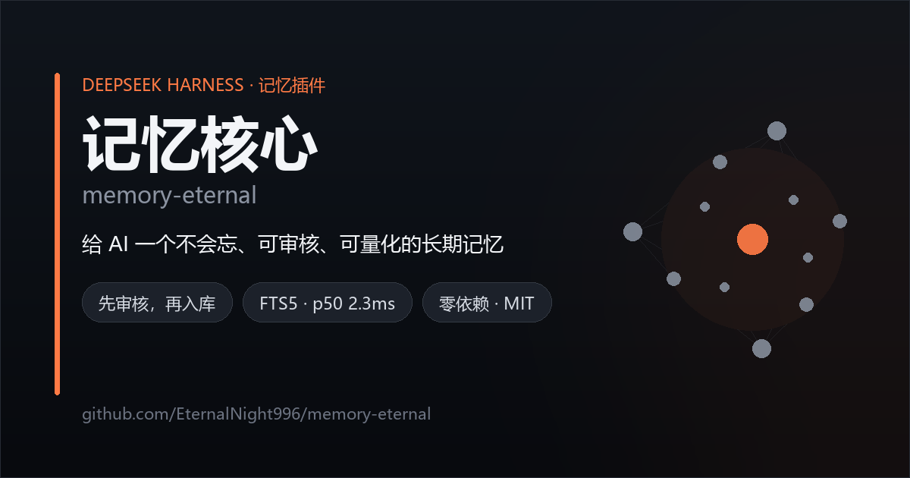
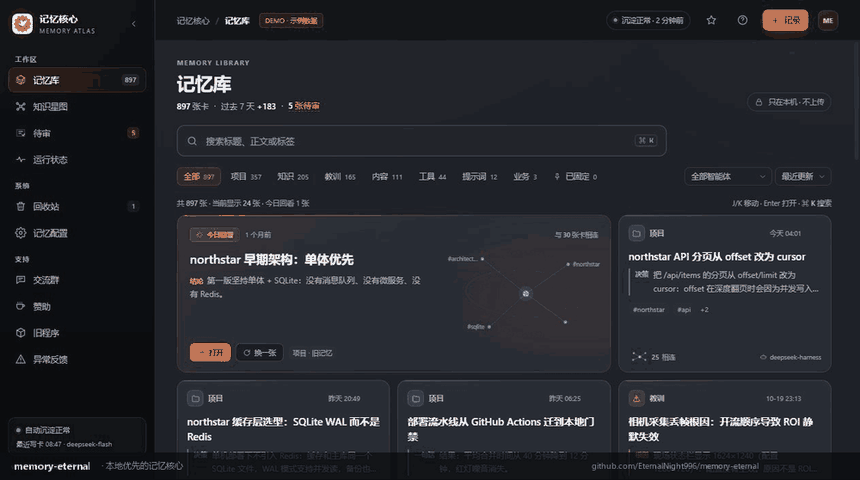
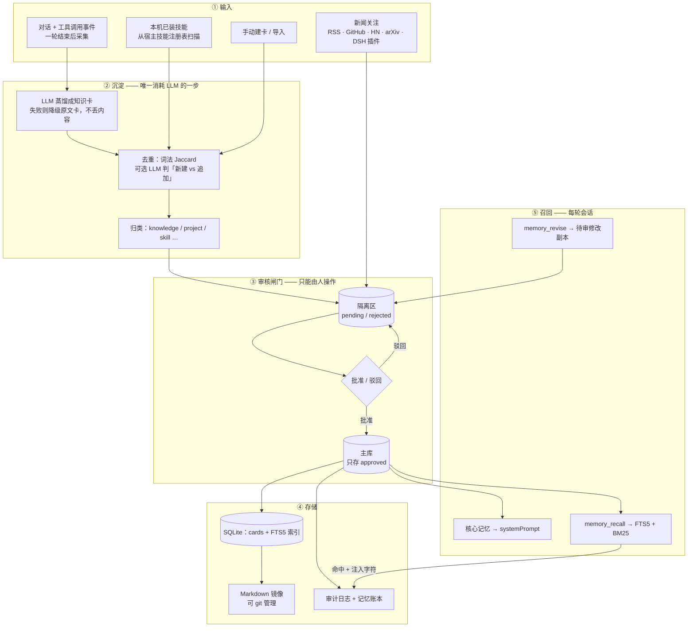
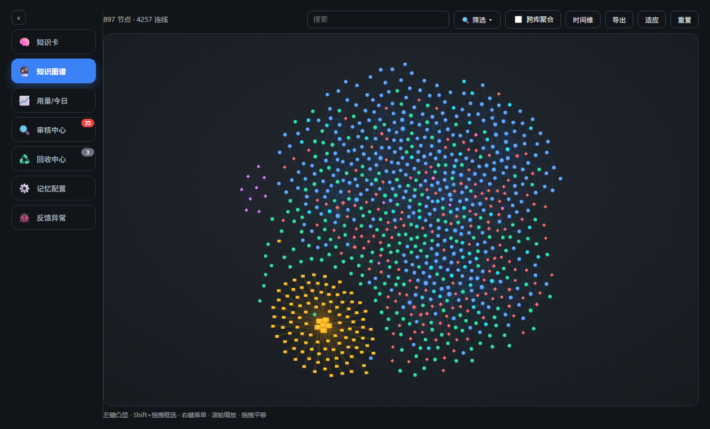
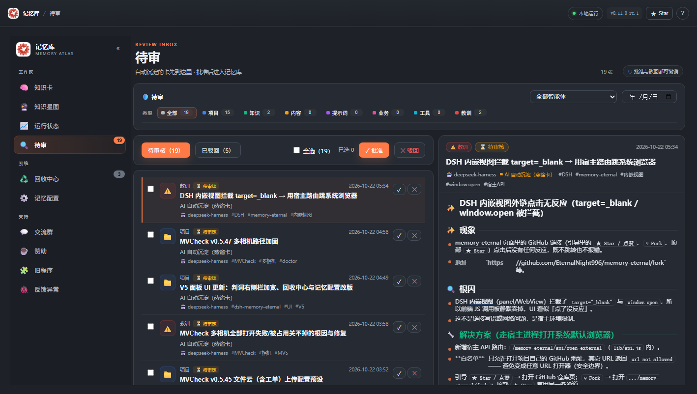
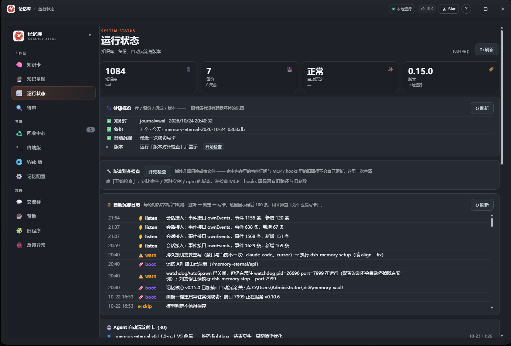
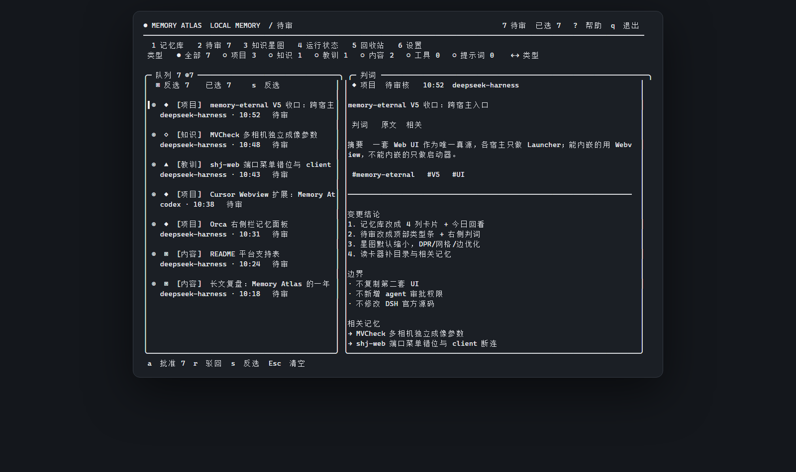
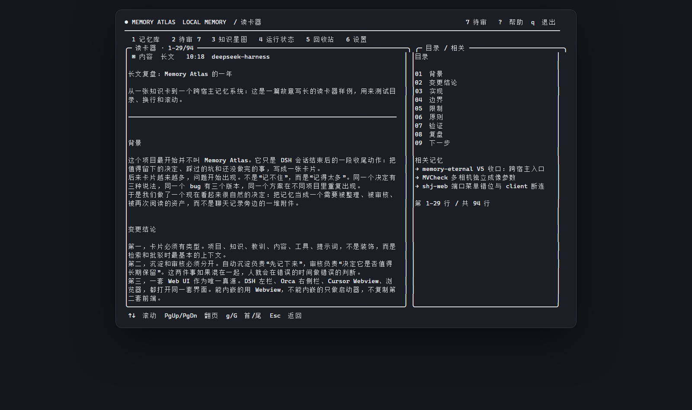

# 🧠 memory-eternal —— 给 AI 装一个可信的第二大脑

<p align="center">
  
</p>

**记忆核心（memory-eternal）** —— 给 AI 一个不会忘、可审核、可量化的长期记忆。本地优先 · 审核闸门 · 记忆账本 · 一个库接入 DSH / Claude Code / Codex / Cursor 与任意 MCP 客户端。

[](https://github.com/EternalNight996/memory-eternal/stargazers)
[](https://www.npmjs.com/package/memory-eternal)
[](https://github.com/EternalNight996/memory-eternal/releases)
[](LICENSE)

[English (default)](README.md) · **简体中文（镜像）**

<p align="center">
  <a href="https://eternalnight996.github.io/memory-eternal/demo/"></a>
</p>
<p align="center"><sub>▲ 20 秒演示 —— 审核队列 · 记忆账本 · 知识星图 · <a href="https://eternalnight996.github.io/memory-eternal/demo/">在线 Demo</a></sub></p>

> **你的 AI 每次会话都失忆。给它一个可信的记忆库。**
>
> 本地优先、先审后入、可度量 —— 一个 SQLite 库，DSH / Claude Code / Codex / Cursor 与任意 MCP 客户端共享。

- 🔍 **先审核，再入库** —— 新卡先进待审队列，Web 或终端里批准/驳回；每次状态变更写入不可篡改的审计日志。
- ✏️ **可编辑、可修订** —— 在阅读器里直接改卡片，或让 agent 提交**修改副本**（`memory_revise`）；审核中心把它标成「✏️ 修改」，人批准后才覆盖原卡。
- 🧾 **记忆账本** —— 召回注入了多少、蒸馏调了几次、召回到底有没有用，全部可查。
- 🏠 **本地优先，零云端** —— SQLite + Markdown 存在你自己的磁盘上。没有第三方记忆框架、不需要账号；记忆数据不外发，只有「动态」资讯会按需请求公开 RSS / Hacker News（只取标题、摘要与外链）。
- ⭐ **核心记忆** —— 已批准的卡可提升为「每次会话强制注入」的核心记忆；自动沉淀可以建议，但最终仍由审核中心决定。
- 🧭 **阅读与布局** —— 卡片目录可点击跳转；记忆界面支持紧凑 / 标准 / 大三种布局大小。

<p align="center"><strong>⭐ 如果它帮你少解释了一遍上下文，点个 Star 就是最大的支持</strong><br/><sub>DSH 一条命令：<code>dsh plugin --profile desktop add memory-eternal</code></sub></p>

## ⚡ 快速开始

**DeepSeek Harness（桌面版 / Web）**

```bash
dsh plugin --profile desktop add memory-eternal
# 重开 DSH → 左栏「记忆」
```

**Claude Code、Codex 或 Cursor —— 通过 MCP 共享同一个库**

```bash
npm i -g memory-eternal
dsh-memory connect claude    # 或：codex / cursor
```

**任意 MCP 客户端**

```bash
npx -y -p memory-eternal dsh-memory mcp
```

**浏览器或终端**

```bash
dsh-memory open              # http://127.0.0.1:7999
npx -y -p memory-eternal dsh-memory tui   # 终端里的实时待审队列
```

## 🧬 底层记忆是怎么流动的

一个 SQLite 库、一道写入闸门、两条读取路径。**没过闸门的东西，永远不会被召回。**



这张图之所以成立，是因为三条不变量**写在代码里**，不是写在文档里：

| 不变量 | 由什么保证 |
|---|---|
| 主库**物理上只存 approved** | 两张物理表；所有读取路径只查主库 |
| Agent **永远不能批准自己的记忆** | Agent 只能写进隔离区；批准/驳回是 UI / TUI / CLI 里的人工动作 |
| 召回**零模型调用** | FTS5 + BM25；LLM 只在沉淀时运行 |

## 🔌 Agent 与记忆的交互通道

| 通道 | 方向 | 何时 | 闸门 | 成本 |
|---|---|---|---|---|
| `memory_recall` | Agent → 记忆 | 按需 | 只读已批准 | **0 次模型调用**（p50 2.3ms） |
| 核心记忆 | 记忆 → Agent | 每轮会话自动 | 只读已批准 | 约 0.2k 字符 |
| 会话沉淀 / `memory_write` | 对话 → 记忆 | 一轮结束 | **进待审队列** | 1 次 LLM |
| `memory_revise` | Agent → 记忆 | 按需 | **进待审「修改副本」** | 0 |
| 审核（Web / TUI / CLI） | 人 → 记忆 | 手动 | — | 0 |
| Hook（Claude Code / Codex / Cursor） | 宿主 → 记忆 | 会话结束 | **进待审** | 1 次 LLM |
| MCP 服务 | 任意 MCP 客户端 | 按需 | 同上 | 同上 |
| 新闻关注 | 网络 → 记忆 | 按间隔 / 24h | 与知识卡隔离 | 仅网络 |

## 🧾 真的省 token 吗？

大多数记忆产品都说自己省 token。我们认为你应该自己验证。插件内置**记忆账本**（运行状态 → 记忆账本），记录：

| 记录项 | 含义 |
|---|---|
| 召回：命中数 + 注入字符 | 到底有多少记忆进入了上下文 |
| 沉淀：LLM 调用次数 + 输入/输出字符 | 蒸馏花了你多少成本 |
| 有用率：有用 / 没用 反馈 | 召回的记忆是否真的帮上了忙 |

诚实的算式：

```text
净收益 ≈ 被避免的上下文开销 −（注入字符 + 蒸馏调用 × 单价）
```

| 场景 | 你要付 | 你能省 |
|---|---|---|
| 有决策与踩坑记录的多会话项目 | 每次召回约 0.6–0.9k token | 重新解释上下文（约 1.5–3k）或重读文件（3–6k） |
| 一次性问题、低命中率 | 召回注入 | 通常什么也省不到 |

> 以上是示意数字，不是 benchmark —— 用账本测你自己的。如果召回有用率长期低于约 60%，就调小（更少条数、更短摘要）或直接关掉记忆。

## 📊 与同类产品的实测对比

数据快照：**2026-11-07**。我们的数字在**真实 2,321 张卡的库**上实测（不是玩具语料）；竞品数据取自同一日期的公开 README / npm / GitHub。`—` 表示**未公开或无法核实**，不代表"没有"。

| 能力 | **memory-eternal v0.24.0** | 灵枢 dsh-memory v0.9.23 | SAG-Wiki v0.2.7 | CLAUDE.md / AGENTS.md |
|---|---|---|---|---|
| 存储 | SQLite + Markdown 镜像 | Markdown 认知图 | 对本地文件的 SQLite FTS5 索引 | 单个文件 |
| 写入闸门 | **人工审核队列**（三库分离） | 确定性规则裁决 | 无（索引即真相） | 无 |
| 不可变审计日志 | ✅ SQLite 层强制 | ✅ 官方声称 | — | — |
| 检索 | FTS5 + **BM25/IDF**，多列加权 | 规则化图谱遍历 | BM25 → JEV（LLM 判定） | 整文件注入 |
| 召回延迟 | **p50 2.33ms · p95 6.18ms** | — | — | 随文件体积增长 |
| 召回模型调用 | **0** | 0 | 每次查询 1–2 次 | 0 |
| 记忆账本（可量化有用率） | ✅ | — | — | — |
| 多 Agent | DSH + MCP + Hook + TUI + 浏览器 | DSH + MCP | CLI + Skill | 各工具各自为政 |
| npm 月下载 | 14,370 | **31,421** | 119 | 不适用 |
| GitHub Star | 147 | **612** | 124 | 不适用 |
| 许可证 | MIT | MIT | MIT | 不适用 |

**我们不是这里最大的。** 灵枢的 star 和下载都比我们多；SAG-Wiki 检索你自己文档的能力也比我们强。我们做的不一样的是**写入路径**：人审闸门、三库分离、可指认的审计链条，外加一本让你能自己核对"召回到底值不值"的记忆账本。

在我们的库上自己复跑：

```bash
node scripts/bench-search.mjs --rebuild   # 重建耗时 + p50/p95/max 延迟
dsh-memory ledger --days 30 --json        # 召回注入 / 沉淀调用 / 有用率
```

| 我们实测的基线 | 数值 |
|---|---|
| 索引卡片数 | 2,321 |
| 冷启动全量重建 | 869 ms |
| 召回 p50 / p95 / max | 2.33 / 6.18 / 7.60 ms |
| 召回吞吐 | 约 431 次/秒 |
| 召回模型调用 | 0 |
| 每次召回注入（60 天账本） | 约 1,394 字符 |

## 🛡️ 先审核，再入库

一个「什么都自动吞进去」的记忆系统，迟早会把错误事实当成真相召回。memory-eternal 默认**先审后入**：

- 新卡先进入**待审队列**，人工批准后才进主库；
- 在 Web、终端 TUI 或 CLI 里批准 / 驳回 / 批量处理；
- 每次状态变更追加到**不可篡改的审计日志**（谁 / 什么 / 何时 / 为什么）—— 由 SQLite 层强制，而不是靠约定；
- Agent 可以读取和提议，但**不能批准自己写的卡**；
- Agent 也可以提交**修改**：已批准卡的副本进待审队列并标注「✏️ 修改原卡：…」；批准 = 用副本覆盖原卡（id / path / 状态不变，更新记录留痕），驳回 = 原卡一字不动；
- 删除的卡进回收站（默认保留 30 天）。

## ⭐ 核心记忆

不是所有内容都该每次注入上下文。核心记忆是一组**必须每次遵守**的偏好与硬约束：

- 任意已批准卡片都可以在阅读器或卡片列表里提升为核心记忆；
- 自动沉淀只会在用户明确要求长期偏好 / 硬约束时**建议**核心，且 core 候选**一律待审**；
- 已批准的核心卡每次会话直接注入 systemPrompt，不依赖 `memory_recall` 调用；
- 在「设置 → 记忆 → 核心记忆」里可配置条数上限和字符预算；
- 知识星图里核心节点显示为橙色菱形 + ★；
- **不要把密钥/Token 的值写进核心卡**，只保存凭证目录的引用。

## 🎛 阅读与布局

- 卡片阅读器右侧目录可点击，平滑跳转到对应章节；
- 「设置 → 记忆 → 布局大小」支持 **紧凑 / 标准 / 大**，只影响界面显示。

## 🧩 一个库，所有 Agent

| 入口 | 你能得到什么 |
|---|---|
| **DSH 桌面版 / Web** | 内嵌记忆界面：审核、图谱、配置、账本 |
| **Claude Code / Codex / Cursor** | MCP server，同一个本地库，<code>dsh-memory connect</code> |
| **任意 MCP 客户端** | <code>npx -y -p memory-eternal dsh-memory mcp</code> |
| **终端** | <code>dsh-memory tui</code> —— 实时队列、全选、批量批/驳、长文读卡 |
| **浏览器** | <code>dsh-memory open</code> → http://127.0.0.1:7999 |

## 📸 截图

<p align="center">
  
  
  
</p>
<p align="center"><sub>▲ 知识星图 · 审核中心 · 运行状态</sub></p>

<p align="center">
  
  
</p>
<p align="center"><sub>▲ 终端原生审核与长文读卡 —— <code>dsh-memory tui</code></sub></p>

## 📚 文档与链接

- [英文完整手册](docs/GUIDE.md) · [完整手册（中文）](docs/GUIDE.zh-CN.md)
- [私有化部署（Docker / systemd）](docs/DEPLOY.md)
- [更新日志](docs/CHANGELOG.md) · [架构](docs/ARCHITECTURE.md)
- [终端插件（dsh-tui）](dsh-tui-plugin/README.md) · [Orca 启动器](orca-plugin/README.md) · [Cursor / VS Code 扩展](cursor-extension/README.md)
- [反馈问题](https://github.com/EternalNight996/memory-eternal/issues)

## 💬 交流群

**遇到问题、想提需求、或者想聊聊 DSH 插件开发 —— 欢迎进群：**

| QQ 交流群 | 微信交流群 |
|:---:|:---:|
|  |  |

**如果这个插件帮你省了时间，可以请作者喝杯咖啡（两个码任选其一）：**

| 微信收款码 | 微信赞赏码 |
|:---:|:---:|
|  |  |

> 打赏完全自愿，不影响任何功能；插件本体始终开源免费（MIT）。详见 [SPONSOR.md](SPONSOR.md)。

## 📄 License

MIT —— 随便用、随便自托管、随便二次开发。

## 🖋 作者语录

_「大爱」二字，是全篇最大的反讽。面板左栏底部同步轮播。_

> 落魄谷中寒风吹，春秋蝉鸣少年归。<br>
> 荡魂山处石人泪，定仙游走魔向北。<br>
> 逆流河上万仙退，爱情不敌坚持泪。<br>
> 宿命天成命中败，仙尊悔而我不悔。

> 早岁已知世事艰，仍许飞鸿荡云间。

> 男儿不展凌云志，空负天生八尺躯。

> 千古地仙随风逝，昔日三王归青冢。<br>
> 阳莽悍陨谁无败？卷土重来再称王。

> 天河一挂淘龙鱼，逆天独行顾八荒。<br>
> 今朝暂且展翼去，明朝飞仙笞凤凰！

> 独帜入渊深未知，身似浮萍命难持。<br>
> 千舟皆朝归海处，一苇青拨戏浪巅。<br>
> 惊鸿四散鱼逃尽，唯有残帆傲此间。<br>
> 待到天开云雾散，负手直望笑苍天。

<p align="right"><sub>——《蛊真人》· 大爱仙尊</sub></p>

